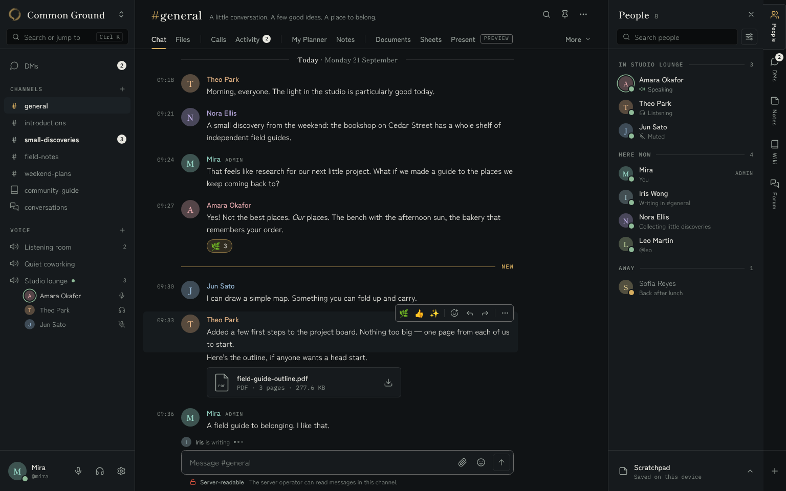
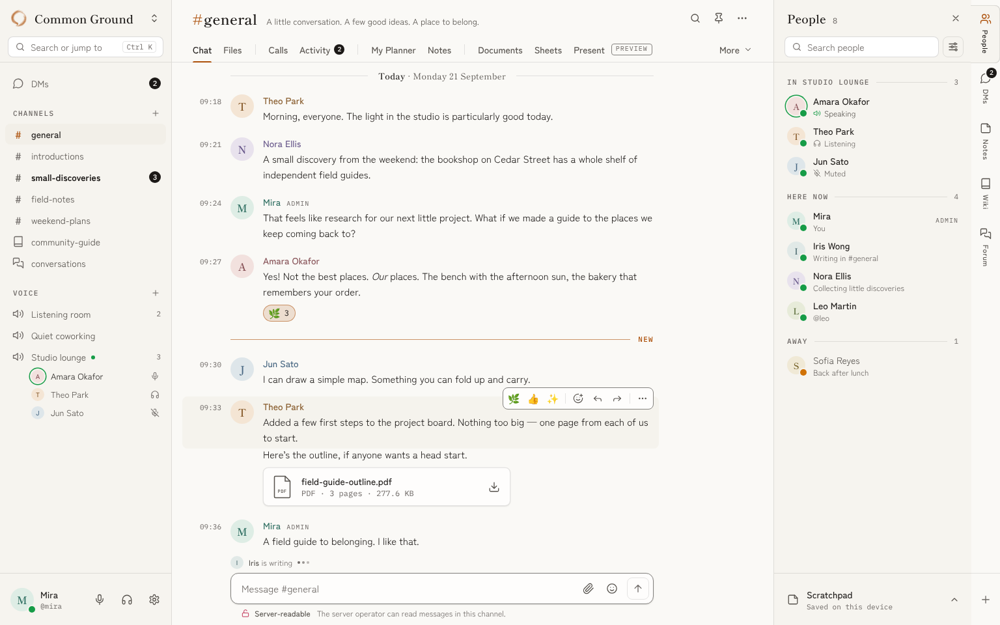
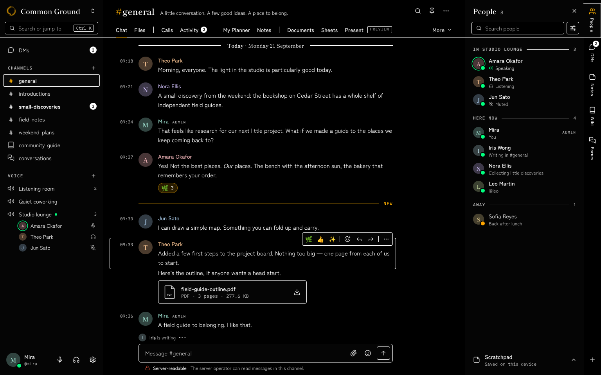
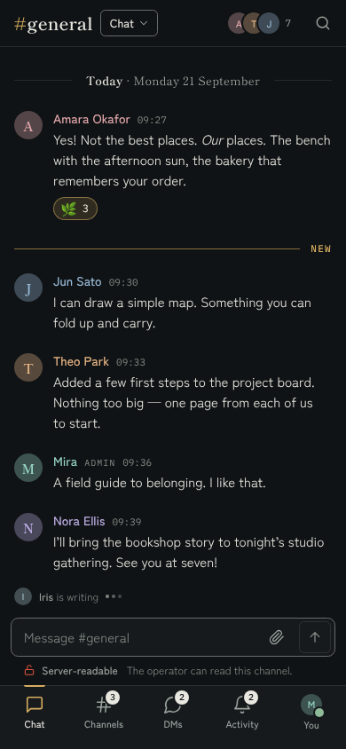
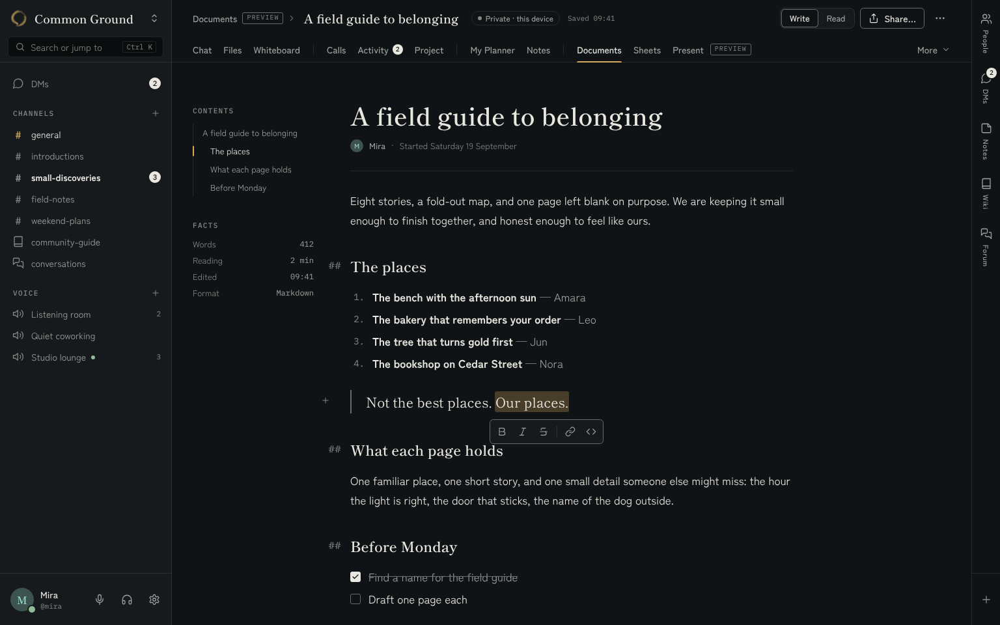
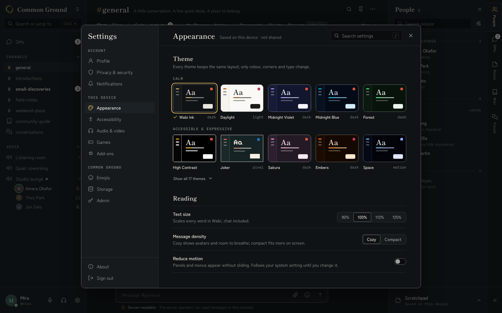

# Wabi design contract

Status: the single contract for the Wabi UI redesign. An implementer reads only this file and the reference mockups listed in §13. It merges the chosen direction (Quiet Ledger) with the grafts its three review judges required, and resolves every conflict explicitly (§3).

This is a **target**, rolled out in waves (§14). The foundation (role tokens; type, radius and motion tokens; the kit; the UI primitives; `privacyState.ts`) lands first, then surfaces are redesigned one package at a time. Where the code and this file disagree, the code shows what ships today and this file shows where it is going. This contract governs UI only: feature maturity is decided by `docs/PROJECT_STATUS.md`, never by a mockup. The one-page summary is [`DESIGN_LANGUAGE.md`](DESIGN_LANGUAGE.md).

- **Identity kept:** the default theme Wabi Ink (warm ink and brushed gold on near-black charcoal, a vermilion seal for privacy, security and moderation), the ensō mark, Shippori Mincho, Zen Kaku Gothic New and IBM Plex Mono.
- **Everything is a role.** Colors come only from the `--w-*` role tokens that every one of the 17 themes answers, from `color-mix()` of those roles, and from per-person identity ink computed in `roles.ts` (§5.5). No raw hex, `rgba()`, named colors or legacy `--surface-*` / `--accent-primary-*` / `--text-*` tokens in new or touched rules.
- **Reference mockups:** the PNGs in [`reference/`](reference/) (§13). They were rendered during the design phase from a standalone mockup kit fed with the projected role tokens; the role math behind them (seal separation, lift, status marks, identity ink) now lives in `frontend/src/lib/theme/roles.ts` and is tested in `roles.test.ts`.
- **Precedence when this file and a mockup disagree:** this file wins; file a note.

Paths in code spans are relative to `frontend/src/` (so `lib/theme/roles.ts` is `frontend/src/lib/theme/roles.ts`) unless they start with `frontend/` or `docs/`, which are repository-relative. A bare file name (`MainLayout.svelte`, `voice-view.css`) is unique under `frontend/src/`. Links to the reference images are relative to this file.

---

## 1. Thesis

**Wabi reads like a well-set book that a small community writes in together.**

| Book part | Wabi part |
|---|---|
| Table of contents | Sidebar: the channels, which anchor where you are |
| The page | Center stage: the one task you are doing |
| Margin note | Companion panel: optional, beside the page, never instead of it |
| Folio tabs at the page edge | Workspace navigation (labeled words) |
| Colophon | The privacy line under the composer: plain words about who can read this |

Structure comes from type, measure and hairline rules, not boxes. Color appears only when it means something: gold (`--w-sig`) says "you are here", accent says "this is on / focused", vermilion (`--w-seal`) says "this is about who can read it", a person's identity ink says "this is them". Chrome stays quiet until you reach for it.

---

## 2. Principles

1. **Rules, not boxes.** Hairlines (`--w-line` at `--w-bw`) separate regions. A box is earned only by an *object* you act on as a unit (attachment, task card, call card, dialog) or a *control edge* (button, field, composer). Lanes, lists, panels and settings groups never get a border box.
2. **Two running rules.** The sidebar, stage and companion share one 96px masthead whose bottom hairline runs across all columns at the same y, and one 80px footer band whose top rule runs across sidebar foot, composer field top edge, Scratchpad tray and rail.
3. **Serif names places, sans carries voices, mono counts.** Shippori Mincho: community, channel, room, document, panel, dialog titles and date rules. Zen Kaku Gothic New: everything people say and do. IBM Plex Mono: times, counts, handles, sizes, hosts, kickers, maturity tags.
4. **Ink on paper for action.** The primary action is a `--w-text` fill with a `--w-bg` label. Accent fills mean state (switch on, range fill, selection), never "primary". At most one primary button per view.
5. **Color is rationed** (§5.1). Decoration is never colored.
6. **Words over glyphs.** Workspace tabs are words, stubs show their label, every state is named ("Server-readable", "Only you · this device", "Saved 09:41"), role marks are words ("ADMIN"). Icons support words; they replace them only for universal verbs (search, close, more, attach, send, add). No text glyphs (⋯ ▲ ☆ ◇ ✕ +) or emoji in chrome.
7. **Nothing moves under the pointer.** Hover changes color or fill, never size or position. Tabs never grow. Dragged cards are the only things that lift.
8. **Truth is typography.** Privacy, locality and maturity labels have a fixed place, grammar and words (§9). A truth label never shrinks to a bare glyph, including on phones. Each truth is said once per screen at its entry point (plus once inside Share).
9. **Designed for each width.** Phone (<600), tablet (600–1249), desktop (≥1250). Stage-dependent layout uses container queries on the stage (`container: stage / inline-size`), not viewport media queries.
10. **Real states.** Every async surface has loading, empty and error states with their own words, rendered where the action happened, inside the visible area.

---

## 3. Decisions and conflict resolutions

Three directions were explored (Quiet Ledger, Instrument, Studio) and scored by three review judges (visual, product, implementability). Totals: Ledger 26.0, Instrument 23.8, Studio 22.2. No disqualifying flaw was found in Ledger, so it is the base. The table lists every graft and every conflict with the side taken.

| # | Topic | Decision | Source / reason |
|---|---|---|---|
| D1 | Base language | Quiet Ledger: masthead rule, labeled folio, colophon, HC rings, editor header in masthead row A, real states, role-built theme previews | All three judges |
| D2 | Stub labels | **Vertical** 11px labels (current code) inside the pinned folder-tab treatment. Horizontal labels rejected: "Transfers", "Models" and plugin `shortLabel`s do not fit 44px unabbreviated | Implementability judge over the visual graft |
| D3 | Daylight lift | New derived role `--w-lift` from `roles.ts` (dark: `bg2`; light: `bg` mixed 70% toward white) plus `--w-shadow-1` in `character.css`. `--w-lift → --w-sink` rejected (inverts the sink role, breaks custom light themes) | Studio idea, implementability constraint |
| D4 | Identity ink | OKLCH lightness clamp keeping hue and chroma, then `ensureContrastOnAll` 4.5:1, computed in `roles.ts` (JS), memoized per theme. No CSS `oklch(from …)` (WebKitGTK/WKWebView risk). Delete the `brightness(.6)` filter | Studio idea, Ledger mechanism |
| D5 | Role marks | The word `ADMIN` / `MOD` in `--w-t-micro` uppercase `--w-faint`, no box, after the name. Never a glyph, never accent, never seal | Product + implementability judges |
| D6 | DM destination name | **"DMs"** everywhere (sidebar row, stub, phone nav, panel title, hub title). Friends is a segment inside DMs. "Home"/"Messages" retired for this place. Server home is reached only by the community block | All judges: one name per place |
| D7 | Encryption pending sentence | "Messages wait for everyone's devices. You can choose to send server-readable instead." Ledger's "Nothing is sent until you choose" rejected (misstates behavior) | Studio copy |
| D8 | Retention | Its own clock chip beside the colophon state, reading the duration. Never part of the privacy word, never "private" | Studio |
| D9 | PREVIEW placement | Once in the folio after the Office group, plus the editor crumb, More menu hint, phone Workspaces sheet, gate kicker and library title | Instrument + product judge |
| D10 | Phone top | One 52px bar: title (heading, not a button) + "Chat ▾" workspace button + People facepile + search. No horizontally scrolling folio. The channel drawer opens only from the bottom-nav "Channels" | Instrument + Studio; removes duplicate path |
| D11 | Tablet peek backdrop | Full `--w-scrim` with tap-to-close, not a 40% `bg` veil | Instrument |
| D12 | Quick switcher | New `JumpPalette.svelte` (Ctrl K) opened by the sidebar search field. `CommandPalette.svelte` stays the composer's slash list | Instrument palette, implementability naming |
| D13 | Shortcuts | Ctrl K = palette everywhere; Documents link = Ctrl Shift K. No Alt 1–9. Single-letter keys only while a card or message has focus. Keycaps appear only in tooltips, menus, the palette and the `?` sheet | Product + implementability judges |
| D14 | Dev tone | No Ln/Col status bar, no persistent keycap legends, no uppercase mono day kicker | All judges |
| D15 | Day rule weight | Serif 400 with "Today" at 600 (500 is not loaded) | Implementability |
| D16 | Token names | Type tokens are `--w-t-*` | Implementability |
| D17 | Radii | Keep `--radius-sm/md/lg/xl` names and values; add only `--radius-inner` (6). No parallel scale | Implementability |
| D18 | Planner board | No full-height lane hairlines. Lane head = drawn status glyph + name + count + always-visible add; rule under head; lanes hug content; quiet "Add task" row at lane end; cards on `--w-lift` | Visual + Studio + Instrument |
| D19 | Small floating tools | Hover toolbar, selection bubble, tooltip anchor tools: `--w-line-strong` edge and **no** blur shadow. `--w-shadow` only on menus, popovers, dialogs, sheets, peeks and a dragged card | Instrument |
| D20 | Chat measure | Text column max 600px × `--w-fs`. The day rule, NEW rule, typing row and composer all end at the same right edge (avatar column → text column end) | Fixes Ledger's composer/measure mismatch |
| D21 | Footer band | `--foot: 80px` rule shared by sidebar foot, composer field top, Scratchpad tray and rail add | Instrument + Studio |
| D22 | Document blocks | Inline marks: selection bubble. Blocks: a quiet "+" handle in the left margin of the caret block, and `/` at line start, open one Insert menu. On phones the same controls dock above the keyboard | Product judge; no third band |
| D23 | Locality on Documents | Said once (header chip) and in Share. Doc meta line shows author and started date only | Product judge |
| D24 | Seal hue | Seal must be ≥30° OKLCH hue from accent; candidates vermilion → crimson lake → indigo ink (§5.4) | All judges: land first |
| D25 | People companion | Grouped by where people are (room, Here now, Away, Offline) with voice sublines; role sort in the filter menu | Studio |
| D26 | Avatars | Serif single-initial stamps on an identity tint at 28px and up; sans 500 initial below 28px | Studio |

Rejected outright (do not reintroduce): icon-only workspace tabs; the Office umbrella tab with a Documents/Sheets/Present segment; three-band editor chrome; inset rounded "page on desk" shell; pill day separators; 12-hour mono times as default (time follows the locale; 24-hour in the reference); a seal shield beside admin names; the ensō filled with `--w-text`; names mixed 45% toward text; top-of-stream fade masks; HC selection as a fill only; privacy status above the composer field; "Sign out" in danger red; High Contrast hidden behind a segment tab.

---

## 4. Tokens

### 4.1 Type scale (`styles/typography.css`)

Every size and line height is `calc(Npx * var(--w-fs))`; line heights are integer pixels (this also prevents the fractional overflow that put scrollbars on messages). Each style is a `font` shorthand token with a matching utility class `.w-t-<name>`.

| Token | Family | Size / line | Weight | Tracking | Use |
|---|---|---|---|---|---|
| `--w-t-display` | serif | 32 / 40 | 600 | 0.005em | Library and empty-state titles; start-of-channel (28/34); document H1 (38/46, `text-wrap: balance`) |
| `--w-t-title` | serif | 22 / 28 | 600 | 0.005em | Stage masthead names (`#general`, `My Planner`), dialog and settings titles; phone bar title 20/26 |
| `--w-t-heading` | serif | 18 / 24 | 600 | 0 | Community name, companion titles, settings sections, document title in the crumb (19/24), prose H2 (22/30) |
| `--w-t-subhead` | serif | 15 / 20 | 600 | 0 | Popover titles, call room names (16/22), forum list titles (17/24) |
| `--w-t-read` | sans | 17 / 30 | 400 | 0 | Documents, wiki pages, forum posts (measure 68ch) |
| `--w-t-chat` | sans | 15 / 24 | 400 | 0 | Message bodies, composer (phone 15/23) |
| `--w-t-label` | sans | 14 / 20 | 500 | 0 | Buttons, author names, row labels, folio tabs, card titles, member names |
| `--w-t-label-sm` | sans | 13 / 18 | 500 | 0 | Segmented options, the phone "Chat ▾" button |
| `--w-t-ui` | sans | 14 / 20 | 400 | 0 | Channel rows, fields, menu items, dialog body |
| `--w-t-small` | sans | 13 / 18 | 400 | 0 | Topic, hints, descriptions, card body; secondary lines 12/16 |
| `--w-t-caption` | sans | 12 / 16 | 500 | 0 | Chips, tags, colophon state word, card meta |
| `--w-t-kicker` | mono | 11 / 16 | 500 | 0.12em, uppercase | Section kickers (CHANNELS, IN STUDIO LOUNGE, CONTENTS), NEW |
| `--w-t-mono` | mono | 12 / 16 | 400, `tnum` | 0 | Handles, file meta (`PDF · 3 pages · 277.6 KB`), hosts, ids, facts values |
| `--w-t-micro` | mono | 11 / 14 | 400, `tnum` | 0 | Timestamps, "Saved 09:41", counts. Maturity tag and role word: 10px, 0.1em, uppercase |

**Faces and weights actually loaded** (`styles/fonts.css`): Zen Kaku 400/500/700; Shippori 400/600/700; Plex Mono 400/500; Pixelify 400/600. Rules:
- Sans uses only 400, 500, 700. Codemod every `font-weight: 600–780` on sans: 600–650 → 500 for labels/controls, → 700 for unread/emphasis; 660–780 → 700.
- Serif uses 400 and 600. Mono uses 400 and 500. Never mono 600.
- `font-synthesis-weight: none` on `:root`.
- **Size floor 11px**, except the count numerals inside `badge--sm` and the 10px maturity tag / role word (mono, uppercase, tracked).
- **Ellipsis fix:** Shippori draws U+2026 as a centered CJK "···". Add `@font-face { font-family: 'Wabi Ellipsis'; src: url(<@fontsource zen-kaku-gothic-new latin-400 woff2>); unicode-range: U+2026; }` and prepend `'Wabi Ellipsis'` to `--w-serif` and to the pixel character's `--w-serif` override.
- `text-wrap: pretty` on message bodies and prose; `balance` on display titles.

### 4.2 Spacing

Scale: 2 · 4 · 8 · 12 · 16 · 20 · 24 · 32 · 40 · 48 · 64. Reuse the existing `--space-*` names (4px base) and add `--space-0_5` (2px). Rhythm: 4 inside a control; 8 between icon and label and between sibling controls; 12 row padding; 16 panel inset; 32 stage gutter (24 at ≤1100px, 16 on phones); 32 between sections; 48–64 around empty states and document tops.

### 4.3 Shell metrics (custom properties on `.app-container`)

| Token | Value | Notes |
|---|---|---|
| `--w-head-a` | 56px | Masthead row A: sidebar community header, stage object row, panel title row |
| `--w-head-b` | 40px | Masthead row B: sidebar search, stage folio, panel search + filter |
| `--w-mast` | 96px | One hairline at y = 96 across all columns |
| `--w-foot` | 80px | Footer band: sidebar foot, composer, Scratchpad tray, rail add |
| `--w-sb-w` | 264px | 252px at ≤1100px; compact rail 60px |
| `--w-panel-w` | 304px | User-resizable 240–744px, clamped so the stage keeps ≥ 600px (§8.4) |
| `--w-rail-w` | 44px | Stub rail (today 46px; change to 44) |
| `--w-gutter` | 32px | 24px at ≤1100px; 16px on phones |
| `--w-measure` | `calc(600px * var(--w-fs))` | Chat text column |
| Channel row | 32px | 44px under `(pointer: coarse)`; grid `20px 1fr auto`, column gap 10, margin 0 8, padding 0 8 0 10 |
| Member row | 46px | Avatar 28 |
| Message grid | `52px 36px minmax(0, 1fr)` | Column gap 14; group start margin-top 18; continuation 2 |
| Composer field | 48px | 44px on phones; colophon row 24px (32px on phones) |

### 4.4 Radii (`styles/character.css`)

Every radius is `calc(Npx * var(--w-rs))` (`--w-rs`: Ink 0.7, soft 1, High Contrast 0.5, Joker 0.2).

| Name | Base | Use |
|---|---|---|
| `--radius-sm` | 4 | Checkbox, maturity tag, kbd |
| `--radius-inner` (new) | 6 | Anything nested one level inside an 8px container: segment option, menu item, tooltip, block handle. Rule: inner = outer − inset |
| `--radius-md` | 8 | Buttons, fields, selects, rows, task cards, attachments (replaces the kit's literal 10) |
| `--radius-lg` | 12 | Composer, popovers, menus, call cards, toast; theme previews use 10 |
| `--radius-xl` | 16 | Dialogs; sheets (top corners only) |
| `--w-pill` | 999px | Tags, chips, badges, reactions, switch |
| `--w-avr` | 50% | Avatars (Joker: 6px squares) |

Codemod for literals: 2–5px → `sm`; 6 → `inner`; 7–10 → `md`; 11–14 → `lg`; 15–24 → `xl`; 999px → `--w-pill`; 50% → `--w-avr`.

### 4.5 Surfaces, elevation and borders

| Plane | Surfaces | Edge | Shadow |
|---|---|---|---|
| 0 page | Stage `--w-bg`; sidebar and companion `--w-bg2`; rail `--w-bg` | Column hairlines `--w-line` | none |
| 1 objects in flow | Attachments, task cards, call cards, composer, theme previews, menu-button selects: `--w-lift` | `--w-line` for objects; `--w-line-strong` for input objects (composer, form fields) | `--w-shadow-1` |
| 2 overlays | Popovers, menus, dialogs, sheets, tablet peek: `--w-bg2` (light: `--w-lift`; dialogs `--w-bg`) | `--w-line-strong` | `--w-shadow` |
| Small floating tools | Hover toolbar, selection bubble: `--w-bg2` (light `--w-lift`) | `--w-line-strong` | none |
| Inverse | Tooltip, toast | none | toast only `--w-shadow` |

New tokens:
- `--w-lift` (role, `roles.ts`): dark modes `bg2`; light mode `mix(bg, #ffffff, 0.7)` (Daylight `#fefdfc`); contrast character `bg2`.
- `--w-shadow-1` (`character.css`): default `0 0 0 0 transparent`; `[data-mode=light]` `0 1px 2px color-mix(in srgb, var(--w-text) 10%, transparent), 0 0 0 0.5px color-mix(in srgb, var(--w-text) 4%, transparent)`; `[data-char=pixel]` `2px 2px 0 var(--w-sink)`; `[data-char=contrast]` `0 0 0 0 transparent`. It must always be a valid shadow (never `none`) because it is composed in lists such as `box-shadow: 0 0 0 1px var(--w-line-strong), var(--w-shadow-1)`.
- High Contrast: `:root[data-char='contrast'] { --w-line: var(--w-line-strong); }` so every rule is solid.

No gradients on surfaces. The only gradients allowed are alpha masks for overflowing horizontal strips and image scrims. No glows, no frost.

### 4.6 Focus

- Default `outline: 2px solid var(--w-accent); outline-offset: 2px`. No stacked box-shadow ring. Delete the global `*:focus-visible { box-shadow }` in `base.css`.
- Inset (`outline-offset: -2px`) inside menus, segmented controls, tab strips and any `overflow` container.
- Fields: border `--w-accent` plus `--w-ring` (`0 0 0 3px var(--w-accent-soft)`).

### 4.7 Motion

| Token | Value | Use |
|---|---|---|
| `--w-dur-1` | 120ms | Color, border, opacity |
| `--w-dur-2` | 180ms | Menus, popovers, tooltips (after 400ms hover delay), switch thumb |
| `--w-dur-3` | 240ms | Peeks, sheets, drawers, dialogs |
| `--w-ease` | `cubic-bezier(0.2, 0, 0, 1)` | Entrances; exits run at 0.75× |

Entrances: opacity plus ≤8px translate along the axis they come from. No scale on hover or press (delete `polish.css` touch scale). Never `transition: all`. Jump-to-message: `--w-accent-soft` fading over 1.6s. No infinite animations in chrome (no pulsing badges or record dots). Reduced motion (system or the Settings switch, which sets `data-motion='reduce'` on `<html>`): durations 0.01ms, no translate, the jump highlight becomes a static 1s tint, typing dots static; "Recording 02:14" stays as text.

---

## 5. Color

### 5.1 Role usage

| Role | Is for | Never for |
|---|---|---|
| `--w-bg` / `--w-bg2` / `--w-raise` / `--w-sink` | Page / columns and overlays / hover and selected rows / inside fields and switch tracks | Tinted gradients, alpha copies |
| `--w-lift` | Objects in flow (cards, attachments, composer, selects), segmented key in light mode | Rows, columns |
| `--w-text` | Content; primary button fill; badges; tooltip and toast surface | — |
| `--w-mute` | Secondary text, idle tabs and icons, read channels | Sole carrier of required information |
| `--w-faint` | Times, kickers, counts, placeholders, role words (≥4.5:1 guaranteed) | Body copy |
| `--w-deco` | Purely decorative marks (empty-state ensō) | Any text |
| `--w-sig` | *Where you are*: active channel glyph, active folio underline, ensō, active settings icon, current outline heading, pinned stub icon, phone nav icon + mark | Buttons, status |
| `--w-accent` | *State*: focus ring, switch on, range fill, selection and caret, NEW rule, "Mic here", your reaction, selected theme, links, applied filter | Primary fills, tags, decoration, role marks |
| `--w-seal` | *Who can read it*: colophon glyph, encryption chips, permission rows, protected ranges, moderator actions in menus | Selection, danger zones, categories, admin badges, decoration |
| `--w-online` | Presence dot, speaking ring, live voice-room dot | Done states, outlines |
| `--w-danger` | Destructive actions (outlined until hover), errors, "Not delivered", overdue | Unread marker, Sign out |
| `--w-warn` / `--w-info` / `--w-ok` (new) | 7px status marks with words: "High" priority, "Unsaved changes", "Solved", info notices, away dot | Text |

### 5.2 Selection grammar (one everywhere)

- **Selected row:** `--w-raise` fill, label `--w-text` 500, leading glyph `--w-sig`. High Contrast adds `box-shadow: inset 0 0 0 1px var(--w-line-strong)`. No left bars anywhere.
- **Hover:** `color-mix(in srgb, var(--w-raise) 70%, transparent)` fill (messages 60%). High Contrast: inset 1px `--w-line-strong` ring instead of fill.
- **Context** (the channel you came from while another workspace is in center stage): no fill, glyph `--w-sig`, label `--w-text`.
- **Tabs:** label `--w-text` plus a 2px `--w-sig` underline (top radii 2px) sitting on the masthead rule.
- **Segmented:** the selected key is paper: `--w-bg` (light: `--w-lift`), `--w-text`, ring `0 0 0 var(--w-bw) var(--w-line-strong), var(--w-shadow-1)`. Never an accent fill.
- **Selected theme / card:** 2px `--w-accent` outline at 3px offset plus a check.

### 5.3 Status marks

Status is a 6–7px dot or a 12–14px glyph *plus a word*. Never a colored frame, stripe or left bar. Away = `--w-warn` dot; offline = hollow ring (`--w-faint` 1.5px); busy = `--w-danger` dot.

### 5.4 Required `roles.ts` changes (land first)

`readableOn` (on-accent by real contrast) and `line-strong ≥ 3:1` already ship. The remaining work:

1. **Seal hue separation.**
   ```ts
   export const SEAL_CANDIDATES = ['#D9543C', '#C23A5C', '#3D6FB6']; // vermilion, crimson lake, indigo ink
   export const SEAL_MIN_GAP = 30; // OKLCH hue degrees
   // seal = theme seal if hueGap(seal, accent) >= 30, else the first candidate with hueGap(candidate, accent) >= 30
   // then ensureContrastOnAll(seal, [bg, bg2, raise, sink], text, char === 'contrast' ? 4.5 : 3)
   ```
   `hueGap` is the circular difference of OKLCH hues (helpers `toOklch`/`fromOklch` with chroma gamut-reduction; implemented in `lib/theme/roles.ts`). Expected results:

   | Theme | Accent | Old seal (gap) | New seal (gap) | Seal on bg |
   |---|---|---|---|---|
   | wabi-ink | #d6ad5f | #e0553f (51°) | unchanged | 4.92 |
   | light (Daylight) | #ac500a | #d07207 (9°) | #C23A5C (39°) | 4.92 |
   | dark (Midnight Violet) | #b698ff | #8352da (0°) | #D9543C (96°) | 4.48 |
   | high-contrast | #ffb000 | #ff8c00 (18°) | #D9543C (44°) | 5.28 |
   | blue | #06b6d4 | #0ea5e9 (22°) | #D9543C | 4.96 |
   | forest | #4ade80 | #22c55e (2°) | #D9543C | 4.74 |
   | ember | #f97316 | #ef4444 (22°) | #C23A5C (38°) | 3.81 |
   | sakura | #f5a0c0 | #ff8cb8 (1°) | #D9543C (37°) | 4.22 |
   | spire, matrix, warp, storm, diamonds | — | <30° | #D9543C | ≥4.64 |
   | space, joker, synapse, longcat | — | ≥41° | unchanged | ≥3.40 |

2. **`--w-lift`** as in §4.5.
3. **Status marks** `--w-warn`, `--w-info`, `--w-ok` = `ensureContrastOnAll(colorWarning|colorInfo|colorSuccess, surfaces, text, 3)`.
4. **Identity ink** (§5.5) exported as `identityInk(color, theme)`.
5. **Tests** in `lib/theme/roles.test.ts`, looped over all 17 `THEMES`: seal hue gap ≥ 30° from accent; seal ≥ 3:1 (HC ≥ 4.5) on bg, bg2, raise, sink; `--w-lift` lighter than or equal to `bg` in light mode and equal to `bg2` in dark; warn/info/ok ≥ 3:1; identity ink ≥ 4.5:1 on bg, bg2, raise for the 8 showcase colors and for 64 random hex colors; initial on disc ≥ 4.5:1.

### 5.5 Identity colors

Identity colors are user data (any hex). They are never used raw.
- **Name ink** = `identityInk(color, theme)`: convert to OKLCH; clamp L to `[0.76, 0.90]` in dark modes, `[0.30, 0.50]` in light, `[0.84, 0.97]` in contrast character; cap chroma at 0.13 (dark/contrast) or 0.15 (light), reducing chroma until inside sRGB; then `ensureContrastOnAll(result, [bg, bg2, raise], text, 4.5)`. Memoize per (theme id, color).
- **Avatar disc** = `mix(bg2, color, 0.30)` (light 0.26). **Initial** = name ink nudged to 4.5:1 on the disc.
- Emitted per element as inline custom properties `--ink`, `--disc`, `--on` (never global). `ProfileName.svelte` applies `color: var(--ink)`; delete `shell.css:211–215` (`filter: brightness(0.6) saturate(1.25)`).
- Verified minimum contrast for the 8 showcase colors (name ink on bg/bg2/raise, initial on disc): Ink 8.2/4.6, Daylight 5.0/4.7, Midnight Violet 8.0/4.5, High Contrast 11.8/6.3, Joker 7.3/4.5.
- **Project and event colors** are also user data: only as 6–8px dots or as an 18% tint mixed into `--w-raise` with `--w-text` text; never as text.

---

## 6. Iconography

- 24×24 viewBox, `fill: none`, `stroke: currentColor`, **stroke 1.75**, round caps and joins.
- One component, `lib/components/ui/Icon.svelte` (`<Icon name size />`) backed by one registry `lib/components/ui/icons.ts`. `WorkspacePanelIcon.svelte` becomes a thin wrapper. No inline one-off SVGs in touched components, no text glyphs or emoji in chrome.
- Sizes: 14 inline meta, chevrons in tabs and selects, kicker actions; 16 buttons, menus, fields, chips, toolbars; 18 rows, masthead actions, icon buttons, stubs; 20–22 phone bar and nav; 28 empty-state glyph in `--w-faint`.
- Color: `--w-mute` idle → `--w-text` hover; `--w-sig` for location; `--w-accent` for on.
- One meaning per glyph (unit-test that no two registry ids share path data):

| Glyph | Meaning | Glyph | Meaning |
|---|---|---|---|
| `#` (typeset, sans 500 16px) | Text channel | Open lock | Server-readable |
| Closed book | Wiki | Hourglass | Encryption pending |
| Two bubbles | Forum | Closed lock | Experimental encryption |
| Speaker | Voice room | Clock | Retention duration |
| Round bubble | DMs | Calendar-check | My Planner |
| Users | People | Bell | Activity |
| Note page | Notes, Scratchpad | Two sheets | Documents |
| Grid | Sheets | Easel | Present |
| Headphones | Listening | Mic-off | Muted |

- **Ensō:** `frontend/static/wabi-logo-small.webp` as a CSS mask filled with `--w-sig` (26px sidebar, 22px phone, 48px empty states in `--w-deco`). Never redrawn, outlined or filled with `--w-text`.

---

## 7. Components

All primitives live in `styles/controls-kit.css` (controls) and the new `styles/kit-overlays.css` (overlays and states), imported in `routes/+layout.svelte` right after `controls-kit.css`. Class names keep the existing `w-` prefix. Svelte wrappers live in `lib/components/ui/`.

### 7.1 Button `.w-btn`
- Heights: `--sm` 28 (`--w-t-caption`, padding 0 10); default 32 (padding 0 12); `--lg` 40 (padding 0 16). 44 under `(pointer: coarse)`. Gap 8, icon 16, `--radius-md`, label `--w-t-label`, `white-space: nowrap`.
- **Default:** transparent, `--w-line-strong` edge; hover `--w-raise` fill (edge unchanged).
- **Primary (ink):** `--w-text` fill and edge, `--w-bg` label; hover `color-mix(in srgb, var(--w-text) 86%, var(--w-bg))`. One per view.
- **Quiet:** no edge, `--w-mute`; hover `--w-text` on `--w-raise`.
- **Danger:** edge 55% `--w-danger`, label `--w-danger`; fills `--w-danger` with `readableOn` label only on hover; always last in a group.
- **Split** (`New task ▾`): two primary halves separated by a `--w-bw` gap showing the page; the menu half is 32×32.
- **Disabled:** opacity 0.45, `cursor: not-allowed`, `aria-disabled` when it must stay focusable.
- **Busy:** label becomes the verb in progress ("Joining…"), `aria-busy="true"`, width locked to the idle width.

### 7.2 Icon button `.w-ibtn`
32×32 (`--sm` 28; 44 on touch), `--radius-md`, 18px glyph (sm 16) in `--w-mute`; hover `--w-raise` + `--w-text`. Always an `aria-label`; toggles add `aria-pressed` (pressed: `--w-raise` fill, `--w-text` glyph). Tooltip after 400ms and on `:focus-visible`.

### 7.3 Field `.w-field`
- 32px in chrome (search), 38px in forms. `--w-sink` fill; `--w-line` edge in chrome, `--w-line-strong` in forms (Daylight chrome fields: 16% text mix so they read at rest). `--radius-md`, `--w-t-ui`, padding 0 10.
- Leading icon 16 `--w-faint`; placeholder `--w-faint` names the scope or gives an example ("Search people", "Message #general") and is never a keyboard manual.
- Focus: border `--w-accent` + `--w-ring`. Inline `kbd` hint allowed in search fields (`--w-t-micro`, hairline, `--radius-sm`, padding 1 5).
- Counter right-aligned under the field: `--w-t-micro` "12 / 32". Never "bytes".
- Error: edge `--w-danger`, a 12px `--w-t-small` line under the field in `--w-danger` with an icon, `aria-describedby`.

### 7.4 Select and menu `.w-select` + `.w-menu` (replaces every native `<select>` in chrome)
- **Trigger:** 32px, `--w-lift` fill, `--w-line` edge (`--w-line-strong` on hover), `--radius-md`, padding 0 8 0 12; optional `--w-mute` label prefix ("Project"), value in `--w-text`, 16px chevron. **Applied filter:** `--w-accent-soft` fill + `color-mix(in srgb, var(--w-accent) 45%, transparent)` edge.
- **Menu:** `.w-pop` (`--w-bg2`, light `--w-lift`; `--w-line-strong`; `--radius-lg`; `--w-shadow`; padding 6), min 220, max 320 wide, portaled with `position: fixed`.
  - Items 32px (44 touch): reserved 16px icon slot, `--w-t-ui` label, trailing slot for a `--w-sig` check, a `--w-t-micro` shortcut, or a `tag--mat`/hint word. Item radius `--radius-inner`; highlight `--w-raise`.
  - Group labels are kickers; separators hairlines with 6px margins. Danger items last, `--w-danger`. Seal-colored glyph for moderation items.
  - `role=menu` / `menuitemradio` / `menuitemcheckbox`; arrows, Home/End, typeahead; Esc returns focus to the trigger.
- **Phones:** menus open as bottom sheets (§7.13) with 52px rows.
- Built on the existing `lib/components/context-menu/ContextMenu.svelte`; one component serves right-click and button menus.

### 7.5 Segmented `.w-seg`
Track `--w-bg2`, hairline, 2px padding, radius `--radius-md + 2px`. Options 26px tall, padding 0 12, `--w-t-label-sm`, `--w-mute`, radius `--radius-inner`. Selected = paper (§5.2). 2–5 options only; more use a select. `role=radiogroup` + `aria-checked`, or `aria-pressed` for view switches. Focus ring inset.

### 7.6 Switch `.w-switch`
`button[role=switch][aria-checked]`, 36×20 track `--w-sink` with `--w-line-strong` edge; 14px thumb `--w-mute`. On: `--w-accent` track and edge, `--w-on-accent` thumb translated 16px over 180ms. Always paired with a visible label in a settings row. No "ON/OFF" text toggles anywhere.

### 7.7 Checkbox and radio
16×16, `--w-line-strong` edge, `--radius-sm`; checked: `--w-text` fill with a `--w-bg` 12px check (stroke 2.5). Radio: circle, checked dot 8px `--w-text`. Hit area 32 (44 touch) via the label.

### 7.8 Range `.w-range`
18px tall hit area; 2px track `--w-line-strong`; filled part `--w-accent`; 14px thumb `--w-accent` with a 2px ring in the surface color. No scale on hover. Always labelled ("Volume for Studio lounge", value text "64%").

### 7.9 Tags, chips, badges, counts, reactions
- **Tag `.w-tag`:** 22px, pill, hairline, `--w-mute`, `--w-t-caption`, padding 0 9, optional 6px dot. Locality: "Private · this device", "Only you · this device", "Synced to server". Status: "Away" (warn dot), "High" (warn dot).
- **Maturity tag `.w-tag--mat`:** 18px, `--radius-sm`, `--w-line-strong` edge, mono 10px uppercase 0.1em, `--w-faint`, padding 0 6. Words: `PREVIEW`, `EXPERIMENTAL`, `OPTIONAL ADD-ON` (§9). `title` carries the explanation.
- **Role word `.w-role`:** mono 10px uppercase 0.1em `--w-faint`, no box. `ADMIN`, `MOD`, `BOT`. `title="Community admin"`.
- **Seal chip `.w-seal`:** 22px pill, `--w-seal-soft` fill, 60% seal edge, 13px privacy glyph in `--w-seal`, label `--w-text` `--w-t-caption`. Used only where the colophon is not visible: DM headers, thread lists, document Share sheet, palette results.
- **Retention chip:** a `.w-tag` with a 12px clock glyph: "Kept 24 hours", "Kept 7 days", "Live only · not saved". Never "private".
- **Badge `.w-badge`:** ink pill (`--w-text` fill, `--w-bg` numerals), mono 500. 18px with 11px numerals; `--sm` 16px with 10px. 1–99, then "99+". `aria-label="N unread"`. Never animated. Where it overlaps an icon it carries a 2px ring in the surface color.
- **Count `.w-count`:** bare `--w-t-micro` `--w-faint` (room occupancy, totals, section counts).
- **Reaction:** 26px pill, hairline, emoji 15px, count `--w-t-mono`; mine: 55% accent edge + `--w-accent-soft`, `aria-pressed=true`. Unknown emoji renders `:shortcode:` text instead of disappearing. Width never changes on hover. "Add reaction" appears only in the hover toolbar.

### 7.10 Folio: workspace navigation `.w-folio`
- Masthead row B, 40px. Labeled words in `--w-t-label`, gap 18, `--w-mute`; hover `--w-text`. **Active** (`aria-current="page"`, `aria-selected="true"`): `--w-text` + 2px `--w-sig` underline on the masthead rule.
- No icons, no hover growth, no relocation, never unmounted by switching views. The same row in every workspace, office tools included.
- **Groups** separated by a 16px tall `--w-line` hairline (`--w-line-strong` in HC) with 2px side margins:
  1. *This channel:* Chat (named by channel kind: Chat / Threads / Wiki / Gallery), Files, Whiteboard.
  2. *Community:* Calls, Activity (ink `badge--sm` "needs you" count), Project.
  3. *Yours:* My Planner, Notes.
  4. *Office:* Documents, Sheets, Present, then one `PREVIEW` maturity tag (8px after the last office tab). Sheets and Present appear only when the add-on is on for this device.
  5. **More ▾** right-aligned: only the views not on the bar (Media, Reader, 3D viewer, Map, plus anything a tier hid), grouped with kickers, a `--w-sig` check on the current view, hints such as "preview" or "off on this device", and "Pin to bar".
- **Tiers** (`@container stage`, measured on the stage): ≥1000 all; 880–999 Whiteboard and Project move to More; 700–879 also Files, Sheets and Present move (PREVIEW follows Documents); <700 also Activity and Notes move and the topic hides. Phones (<600 viewport) have no folio (§8.12).
- **Right-click** a tab: Open · Open beside (only views with a companion: Notes, People, DMs, Wiki, Forum) · Pin to bar / Remove from bar.
- Keyboard: `role=tablist`, roving tabindex, ←/→, Home/End. Tooltips carry the detail line ("Documents · private until you share · preview").

### 7.11 List rows
- **Channel row `.w-row`:** 32px; grid `20px | name | trailing`; glyph column centered at x = 26 in the sidebar so glyphs, avatars and the search icon share one left edge. Read `--w-mute` 400; unread `--w-text` 700 + ink badge; active = selection grammar; context = sig glyph only. Live voice room: 6px `--w-online` dot after the name, occupancy count always visible. Hover tray (follow, settings) is absolutely positioned over the trailing slot, never takes width, hides the badge while shown, appears on `:focus-within`. Exactly one `aria-current="page"` in the sidebar. Names truncate with ellipsis, never wrap.
- **Voice participant `.w-vp`:** 28px; padding-left 40 so the 20px avatar aligns under channel names; name `--w-t-small`; trailing 14px glyph in `--w-faint` (mic, mic-off, headphones). Speaking: 1.5px `--w-online` ring and name in `--w-text`. Max 5 per room, then "and N more" (`--w-t-small` `--w-faint`).
- **Member row `.w-prow`:** 46px; avatar 28 + presence; name `--w-t-label`; subline 12/16 `--w-faint` with an optional 12px glyph: voice state ("Speaking" with `--w-online` glyph and `--w-mute` text, "Listening", "Muted"), activity ("Writing in #general"), bio, or mono handle. Trailing role word. Away rows: name `--w-mute` 400. Click / Enter opens the profile popout anchored to the row (Message is the primary inside it); it never navigates center stage. `aria-label="Theo Park, in Studio lounge, listening"`, `aria-haspopup="dialog"`.
- **Settings nav item:** 34px, icon 17 `--w-faint` (selected `--w-sig`), `--w-t-ui`; selection grammar.

### 7.12 Avatar stamp `.w-av`
Sizes 20 / 24 / 28 / 32 / 36 / 88. Fill `--disc`, initial `--on`. ≥28px: one initial in serif 600 at 0.44× diameter (36 → 16px). <28px: sans 500 (20 → 10px, 24 → 11px). Profile pictures replace the stamp when present. Presence dot 10px (8px on 20–24px avatars) at bottom-right with a 2px ring in the surface color (`--pres-ring`). Speaking: `0 0 0 2px <surface>, 0 0 0 3.5px var(--w-online)`. Joker: 6px squares via `--w-avr`.

### 7.13 Dialog, sheet, confirm
- **Dialog `.w-dialog`:** portaled (`lib/actions/portal.ts`), `role=dialog`, `aria-modal`, `aria-labelledby` on the panel. `--w-bg`, `--w-line-strong`, `--radius-xl`, `--w-shadow`, over a `--w-scrim` backdrop that is a sibling element. Centered (`dialog:modal { margin: auto }` and `inset: 0; margin: auto` for div dialogs). Sizes: sm 440, md 560, lg 760, settings 1040 × min(808, 100dvh − 64).
  - Header 64px: title `--w-t-title` + optional scope note `--w-t-small` `--w-faint` ("Saved on this device · not shared"); a 32px quiet close icon button (Icon `x`, never "✕").
  - Body padding 28 44. Footer right-aligned: quiet Cancel, then the primary or danger action; hairline top only when the body scrolls.
  - Focus trap (`lib/actions/modalFocus.ts`); Esc closes; focus returns to the opener.
- **Sheet (phones and ≤768px):** bottom sheet, `--radius-xl` top corners, 36×4 `--w-line-strong` grabber, 20px serif title, 52px rows, `padding-bottom: env(safe-area-inset-bottom)`. The scrim is a sibling, never `::before` inside the sheet.
- **Confirm:** dialog sm. Title states the action as a question ("Delete this message?"); one sentence of consequence; quiet "Cancel" + danger "Delete message" (verb + object). Replaces `window.confirm/alert/prompt` (route all through `ConfirmDialog.svelte`).

### 7.14 Popover, tooltip, toast
- **Popover `.w-pop`:** padding 16 18; `--w-t-subhead` title with its glyph; `--w-t-small` `--w-mute` body; optional `dl` of facts (`--w-faint` terms, `--w-text` values, gap 6 14); footer link in `--w-accent` over a hairline.
- **Tooltip:** inverse (`--w-text` fill, `--w-bg` text), `--w-t-caption`, `--radius-inner`, padding 5 9, optional shortcut in `--w-t-micro` at 70% opacity. Portaled `position: fixed` (never clipped by a scroller). 400ms delay; also on `:focus-visible`; Esc dismisses.
- **Toast:** inverse, 360 wide, `--radius-lg`, `--w-shadow`, bottom-center 16px above the composer or phone nav. One line plus at most one action ("Undo"). 5s, paused on hover/focus, `role=status`.

### 7.15 Small floating tools
- **Hover toolbar** (messages): `.w-tool` = `--w-bg2` (light `--w-lift`), `--w-line-strong` edge, `--radius-md`, padding 2, **no shadow**. 28px buttons, 16px glyphs. Order: 3 quick reactions | Add reaction, Reply, Forward | More. Anchored to the *text column's* top-right edge (the page's right edge) at `top: -18px`; it never covers message text. Shown on hover and `:focus-within`. Touch: long-press opens an action sheet instead.
- **Selection bubble** (Documents, wiki edit, notes): same surface. Buttons 30px: Bold, Italic, Strikethrough | Link (Ctrl Shift K), Inline code; on shared documents add Comment. Placed 8px below the selection's last line box, left-aligned to the selection start; flips above when fewer than 52px remain below inside the scroll viewport. Never overlaps the selected text.

### 7.16 Empty, loading, error, notice
- **Empty (list or region):** left-aligned in the content column, never a box inside a box: 28px glyph `--w-faint`, 20px serif title, one `--w-t-ui` `--w-mute` sentence (what is missing + what happens next), one primary action. Example: "No threads in conversations yet" / "Longer conversations live here, so they don't scroll away." / [New thread].
- **Empty (top-level surface: no channels, no documents):** the ensō at 48px masked in `--w-deco` above the same title, sentence and action; top third of the region.
- **Loading:** a 2px indeterminate `--w-accent` line under the masthead (static 34% segment under reduced motion) plus skeleton rows matching the real layout (10px bars of `color-mix(in srgb, var(--w-text) 8%, transparent)`, avatar discs). Never "…" spinners and never an empty message while loading.
- **Error notice `.w-notice`:** rendered where the action was, inside the visible area (never after a 100%-height region). Grid `16px 1fr auto`, padding 12 12 12 14, edge 45% `--w-danger`, fill `color-mix(in srgb, var(--w-danger) 8%, var(--w-bg))`, `--radius-md`; glyph `--w-danger`; bold one-line cause (`--w-t-label`); one consequence line (`--w-t-small` `--w-mute`, e.g. "Your draft and settings are unchanged."); a `w-btn--sm` Retry or Export recovery. `role=alert`. Raw `Error.message` is never shown (log it).
- **Info / warning notice:** same frame with `--w-info` / `--w-warn` glyph and `--w-line-strong` edge, `role=status`.
- **Truthful empties:** a failed list shows the error, never "No shared documents".

### 7.17 Separators in the stream
- **Day rule:** hairlines both sides of a centered serif label 13px 400 `--w-mute`, letter-spacing 0.02em, with the relative word at 600 `--w-text` ("**Today** · Monday 21 September", "**Yesterday** · Sunday 20 September", then "Saturday 19 September"). Starts at the avatar column (66px in) and ends at the page edge. Sticky at the top of the stream while its day is in view (sticky background `--w-bg`, padding 12 0 10). `role=separator` with the full date as `aria-label`. Grouping always breaks at a day boundary.
- **Unread rule:** a hairline at 60% `--w-accent` from the avatar column to the page edge, the kicker **NEW** in `--w-accent` at its end. Never danger. `aria-label="New messages since you last read"`.
- **Typing row:** 24px, from the avatar column: 20px avatar, "**Iris** is writing" (`--w-t-small` 12px `--w-faint`, name 500 `--w-mute`), three 4px dots (static under reduced motion). Two people: "Iris and Leo are writing"; more: "Several people are writing". `aria-live="polite"`, throttled to one announcement per 10s.
- All three render inside the existing keyed `#each` without changing message keys (AGENTS.md rule 3).

### 7.18 Message row
- **Page:** time 52 | gap 14 | avatar 36 | gap 14 | text `minmax(0, var(--w-measure))`. Stream padding `0 gutter 6px (gutter − 8px)`. Bottom-anchored: short conversations sit on the composer.
- **Group start:** margin-top 18. Time `--w-t-micro` `--w-faint`, right-aligned, baseline-aligned with the name (`--w-t-label` in `--ink`), then the role word.
- **Continuation** (same author, <5 min, same day): 2px gap, no avatar; time shows on hover/focus.
- **Body:** `--w-t-chat` `--w-text`, paragraphs 6px apart, no inner scroller (remove `max-height`/`overflow` from `.markdown-content`). Messages taller than 22rem collapse behind a quiet "Show more".
- **Hover:** `color-mix(in srgb, var(--w-raise) 60%, transparent)` behind the row (inset −4px −8px, `--radius-md`); HC: inset ring. Toolbar per §7.15.
- **States without bars:** pinned = 12px pin in the time gutter + "PINNED" kicker after the name; failed = danger dot + "Not delivered" + `w-btn--sm` Retry; sending = body `--w-mute`; edited = "(edited)" `--w-t-micro` `--w-faint` after the body.
- **Compact density:** grid `52px | 120px name | text`, no avatars, reactions inline.
- **Own messages on the right** (setting): bodies right-aligned in the same page; no bubble fills.

### 7.19 Attachments, images, link previews, code
- **File:** `--w-lift`, hairline, `--radius-md`, `--w-shadow-1`, max 380 wide, padding 10 8 10 14, grid `30px 1fr auto` gap 14: drawn page glyph with the extension in mono 7px, name `--w-t-label` with ellipsis over meta `--w-t-mono` `--w-faint` ("PDF · 3 pages · 277.6 KB"), 32px download icon button with `aria-label="Download <name>"`.
- **Image:** max 420×320, `--radius-md`, hairline, on `--w-sink` (transparent PNGs keep a backing), one `--w-t-mono` meta line below. No duplicate caption box.
- **Link preview:** `--w-lift` card max 440, hairline, `--radius-md`: host in `--w-t-mono` `--w-faint`, title `--w-t-label`, 2-line `--w-t-small` description, optional 80px thumbnail right. When no preview exists, render nothing (delete the "preview unavailable" card).
- **Code:** inline `--w-mono` 0.88em, `--w-sink`, hairline, `--radius-sm`, padding 1 4. Blocks: `--w-sink`, hairline, `--radius-md`, mono 13/20, padding 10 12, horizontal scroll inside. Prism token colors are role mixes and are scoped to `.code-block` only (the global prism rule is removed).

### 7.20 Composer and the colophon
- **Placement:** footer band (`--w-foot` 80). The field's top edge sits on the footer rule; it spans from the avatar column to the page edge (same right edge as the rules). When text grows the field grows upward (max 40% of the stage).
- **Field:** height 48 (min), `--w-lift`, `--w-line-strong` edge, `--radius-lg`, `--w-shadow-1`, padding 0 6 0 16. Placeholder "Message #general" (DM: "Message Theo"); textarea `aria-label="Message #general"`. Trailing: attach (clip), emoji, send. Send is a 34px square: quiet hairline while empty (`aria-disabled`), ink primary with text. Focus: `--w-accent` edge + ring.
- **Colophon:** a 24px row under the field (2px gap), aligned with the field's text inset (16px). A `button` (`aria-haspopup="dialog"`) holding the 14px privacy glyph in `--w-seal` and the state word in `--w-t-caption` `--w-mute`, then one plain sentence in `--w-faint` 400, then (if not kept forever) the retention chip, then right-aligned "Shift Enter for a new line" in `--w-t-micro` only while the field is focused and empty.

| State | Glyph | Desktop words | Phone short sentence |
|---|---|---|---|
| Server-readable | Open lock | **Server-readable** · The server operator can read messages in this channel. | The operator can read this channel. |
| Server-readable by choice | Open lock | **Server-readable by choice** · You chose to send without encryption in this conversation. | You chose server-readable. |
| Encryption pending | Hourglass | **Encryption pending** · Messages wait for everyone's devices. You can choose to send server-readable instead. | Waiting for devices. |
| Experimental encryption | Closed lock | **Experimental encryption** · Not independently verified. | Not independently verified. |
| Checking | Hourglass | **Checking privacy…** | Checking… |

  On phones the state word plus the short sentence stay visible; never a bare glyph. In DMs "this channel" becomes "this conversation".
- **One state source:** `lib/privacy/privacyState.ts` exports `privacyStateFor({ channel, encryptSend, dmMode, policy })` → one of the states above. It produces only states the branch can actually derive (today: Server-readable from plaintext, Experimental encryption from `encryptSend`, Server-readable by choice when the sender turned encryption off in a room whose policy is encrypted, Encryption pending when the room policy reports pending devices, Checking while the policy request is in flight). It never infers encryption from retention. The composer, the DM header seal chip, the thread list chips and the palette all render from it (`PrivacyBadge.svelte`, variants `colophon | chip | popover`). The current composer label "End-to-end encrypted" is replaced by "Experimental encryption".
- **Privacy popover** (click the colophon): title = state word with glyph; body: what the operator can read; facts `Room` (`#general · Common Ground`), `Kept` ("Until someone deletes them", "24 hours", "Live only · not saved"), `Encryption` ("Only for DMs and groups" in community channels; "Experimental · not independently verified" in encrypted rooms); footer link "How privacy works in Wabi" (opens `/privacy`).

### 7.21 Companion panel frame `.w-panel`
- Same masthead as the stage. Row A (56): serif `--w-t-heading` title + `--w-t-mono` count, then 28px quiet icon buttons: "Open in center stage" (Notes, Wiki, Forum, DMs) and Unpin (Icon `x`). Row B (40): a search `.w-field` + a 32px filter icon button with a hairline edge that opens a menu (People: `Show` Everyone / Here now / Away / Offline; `Group` By place (default) / By role; `Sort` By name). Active filter: 6px accent dot on the button and a removable chip under row B.
- Body `--w-bg2`, no gradients. Section headers: kicker + flexible hairline + count.
- **Footer band (80):** the **Scratchpad** tray: note glyph 18, "Scratchpad" `--w-t-label`, "Saved on this device" `--w-t-micro` `--w-faint`, chevron-up 28px button (`aria-expanded`). Expanded: grows upward to 280px with the editor; drag edge is a `role=separator`.
- **Stacked mode:** sections get a 40px header (serif 15 title + count + collapse chevron). Reorder lives only on the rail (drag and context menu); no ↑ ↓ × glyph buttons.
- **Resize edge:** `role=separator`, `aria-valuenow/min/max`, ←/→ ±16px (Shift ±64), double-click reset to 304. Invisible at rest; 2px `--w-accent` line on hover/focus.

### 7.22 Stub rail `.w-rail`
- 44px, `--w-bg`, hairline toward the stage. Stub: 18px glyph over a vertical label (`writing-mode: vertical-rl`, sans 500 11px, 0.06em), padding 12 0 14, `--w-mute`; hover `color-mix(in srgb, var(--w-raise) 60%, transparent)`.
- **Pinned stub = folder tab:** `--w-bg2` fill continuous with the panel, `margin-left: calc(-1 * var(--w-bw))` to cover the hairline, hairlines on its three outer sides, outer corners `--radius-md`, glyph `--w-sig`, `aria-pressed=true`. **Peeked stub:** `--w-raise` fill, no tab join.
- Badge `--sm` at the glyph's top-right with a 2px `--w-bg` ring.
- Footer band: the "Add panels" `+` button, 80px tall, hairline top (the footer rule).
- Behavior: click pins (or peeks when the stage would drop below 600px); hover or focus shows a tooltip only, never swaps the pinned panel; right-click: Pin / Unpin first, then Move up / Move down / Remove from rail. Labels unabbreviated: "Transfers", "Models".
- **Add panels** popover: 40px rows (glyph + label + one-line description) and a "Rail" footer group (Side seg Left/Right, Open on hover seg Off/On, quiet "Reset rail").

### 7.23 Stage masthead `StageBar.svelte` and the office editor header
- One component, mounted once for every workspace except Server home and never unmounted on view switches. Height `--w-mast`; padding 0 gutter; row A 56, row B = folio.
- **Row A by workspace:**

| Workspace | Row A |
|---|---|
| Chat / Threads / Wiki / Gallery | `#` (`--w-sig`, serif 400) + channel name `--w-t-title`; topic `--w-t-small` `--w-mute`, one line with ellipsis, a button that opens "About this channel"; actions: search, pinned, ⋯ |
| DM / group | Avatar 28 + name `--w-t-title` + seal chip with the privacy state; actions: call, video, ⋯ |
| My Planner | "My Planner" + tag "Only you · this device" (or "Synced to server") + "Saved 09:41" `--w-t-micro`; actions: view seg (Calendar · Board · Journal · Projects), split "New task ▾", ⋯ |
| Calls | "Calls" + `--w-t-micro` "3 rooms · mic in Studio lounge"; actions: Mic, Sound, Record (one control, §8.5), "Leave all" danger sm, ⋯ (Connection details) |
| Notes / Files / Activity / Project | Name `--w-t-title` + one scope tag; one primary action at most |
| Documents / Sheets / Present | The editor header (below) |

- **Editor header (office tools):** row A *is* the editor header, no extra bands. Left to right: tool crumb (`--w-t-label` `--w-mute`, links to the library) · `PREVIEW` tag · 14px chevron · document title as a borderless serif input (`--w-t-heading` 19px; hover `--w-line-strong` edge; focus accent edge + ring; `aria-label="Document title"`) · locality tag ("Private · this device", or seal chip "Server-readable" + tag "Shared · Editor") · "Saved 09:41" (`role=status`). Right: mode seg (Documents: Write | Read; Sheets: none; Present: Edit | Present split), "Share…" default button with share glyph, ⋯ menu (Export ▸ with format truths, Make private copy, Original file, Private drafts (N), Discuss in chat…, Create private task, divider, Turn off <tool> on this device… (confirm), Server sharing settings (admins only)).
- Below 760px stage width the crumb collapses to the tool glyph and the locality tag to its dot with the full words in the tooltip and in ⋯ (the words stay available, never removed).
- **Search:** quiet icon button that expands into a 280px field "Search messages in #general"; operator syntax help lives in the results dropdown.

### 7.24 Jump palette `JumpPalette.svelte` (Ctrl K)
- Opened by Ctrl K anywhere and by the sidebar search field ("Search or jump to", `kbd` Ctrl K). Portaled dialog 640 wide at top 12vh, `--w-bg2`, `--w-line-strong`, `--radius-lg`, `--w-shadow`, scrim.
- **Input row 56:** 20px search glyph, query in sans 17/24, `kbd` Esc.
- **Scope row 40:** chips Everything, `#` Channels, `@` People, `/` Workspaces, `>` Actions (typing the prefix switches scope).
- **Results:** 44px rows grouped under kickers (Workspaces, Recent documents, Channels, People, Actions): 28px glyph tile, title `--w-t-label` (match characters at 700 with a 1.5px `--w-accent` underline), subtitle `--w-t-mono` `--w-faint`, right-aligned truth labels: `PREVIEW`, "off on this device", "Local draft", seal chip "Server-readable". Highlight `--w-raise`.
- **Footer 36** `--w-bg2`: "↑↓ move · Enter open · Tab next scope" with kbd caps, result count right.
- `role=combobox` + listbox + `aria-activedescendant`. Focus returns to the origin. Empty: "Nothing matches "doc" in Channels. Try Everything." Loading: skeleton rows.

### 7.25 Settings row and disclosure
- **`.w-srow`:** hairline-divided (top rule on the group, bottom rule per row), min 68px, padding 12 0, grid `1fr auto` gap 24: label `--w-t-label` over hint `--w-t-small` `--w-mute`; control right-aligned (seg, switch, select, button). No card boxes around groups (replaces boxed `.w-row`; `.w-row--seal` keeps a seal glyph before the label instead of an inset bar).
- **`.w-disclosure`:** replaces `<details>`: a 40px button row with chevron (rotates 90°), label `--w-t-label`, `aria-expanded`; content indented 0, top rule.

### 7.26 Call card and call dock
- **Call card:** `--w-lift`, hairline, `--radius-lg`, padding 16, `--w-shadow-1`. Row 1: room name (serif 16/22) + one state pill: "Mic here" (`--w-accent-soft`, mic glyph `--w-accent`), "Listening" (`--w-raise`, headphones), "Silent". Row 2: 32px avatars with speaking ring, mic-off marks and listen-only glyphs, then "4 in call" `--w-t-small` `--w-faint`. Row 3: speaker toggle (`aria-label="Silence this call"`), `.w-range` volume, "Leave" danger sm. The "Mic here" card gets a 55% accent edge; no glow, no scale.
- **Call dock** (embedded call): floating pill at bottom center 16px above the footer rule: `--w-bg2`, `--w-line-strong`, `--w-shadow`, radius `--w-pill`, padding 6: 40px icon buttons Mic, Camera, Share screen, then a hairline, then "Leave" (danger, labelled). Toggle states via `aria-pressed`; muted mic shows mic-off glyph in `--w-danger`.

### 7.27 Task card and lane
- **Lane:** no fill, no outline, no full-height rules. Head 44px: drawn status glyph 14px (dashed ring Idea; ring To do; half-filled ring In progress in `--w-accent`; check in circle Done in `--w-ok`), name `--w-t-label` 13px `--w-mute`, mono count, an always-visible 28px quiet `+` (`aria-label="Add task to To do"`), ⋯; a hairline under the head. Lanes hug their cards; the lane ends with a quiet 32px "Add task" row.
- **Card:** `--w-lift`, hairline, `--radius-md`, `--w-shadow-1`, padding 12 14, gap 6. Title `--w-t-label`; description `--w-t-small` `--w-mute` 2-line clamp; meta row (`--w-t-mono` `--w-faint`): due (calendar glyph + "Wed 23"; overdue `--w-danger` "Overdue · Mon 21"), priority mark + word only for High/Urgent (`--w-warn` / `--w-danger` dot), checklist "5/8" + 64×2 progress bar (`--w-accent` on `--w-line`), assignee avatar 20 last. No left stripes, no per-card project chip unless the board spans several projects, no "2d".
- **Done card:** transparent fill, dashed `--w-line` edge, title `--w-mute` 400 with the done date ("Done · Sat 19").
- **Keyboard:** cards are `tabindex=0` in a roving grid; Enter opens; `M` opens "Move task…" (menu: columns as `menuitemradio`, plus Due date…, Assignee…, Priority…); `[` / `]` move one column; drag lifts the card (`--w-shadow`, `--w-line-strong`, −1.2° rotation) over a dashed drop slot. Keys are active only while a card has focus.

---

## 8. Surfaces

### 8.1 Shell and left sidebar ([chat-desktop](reference/chat-desktop-wabi-ink.png))
Grid `[sidebar 264 | stage 1fr | panel 304 (optional) | rail 44]` at `100dvh`; the rail and pinned panel keep the current fixed-position mechanics (`.app-container.rail-on` reserves `--w-rail-w + --w-dock-w`). The server rail (saved servers) stays left of the sidebar only when more than one server is saved.

Sidebar, top to bottom:
1. **Masthead row A (56):** 26px ensō in `--w-sig`, then "Common Ground" serif 18/600 (ellipsis via 'Wabi Ellipsis'). The ensō + name block is the **Server home** button (40px tall, hover `--w-raise`, `aria-current="page"` on Server home). Then a 32px "Switch server" icon button (chevrons up/down).
2. **Masthead row B (40):** search field "Search or jump to" + `kbd` "Ctrl K"; opens the Jump palette (§7.24). No count inside.
3. The masthead rule.
4. **DMs** row (round-bubble glyph, "DMs", ink badge; `aria-label="DMs and friends, 2 unread"`). Margin-top 8.
5. **CHANNELS** kicker + 24px `+` (menu: New channel, New folder, Mark all read). Channel rows (text `#`, wiki book, forum bubbles; folders as 28px disclosure rows with a chevron and kicker-style name).
6. **VOICE** kicker + `+`. Rooms with occupancy counts; a live room shows the 6px online dot; participants listed under the room you are in or that has people (max 5 + "and N more").
7. **Voice status** (only while connected): a 56px row above the foot: live dot, room name `--w-t-label`, "Mic here · listening to 2 more" `--w-t-small` `--w-faint`, a 28px "Connection details" ⋯ and a 28px "Leave" icon button (danger glyph). Replaces the "Voice Connected" card.
8. **Foot (80, footer rule on top):** avatar 36 with presence, "Mira" `--w-t-label` over "@mira" `--w-t-micro`, then Mute, Deafen, Settings as 32px icon buttons with `aria-label` and `aria-pressed`. The presence menu opens from the avatar.

**Server switcher:** overlays the sidebar at the sidebar's width (never center stage): `--w-bg2`, `--w-line-strong` right edge, `--w-shadow`. Kicker "SAVED SERVERS", the current server in serif 18, its host in `--w-t-mono` without scheme, the line "Each server keeps its own account." Rows 52px (ensō or server icon 28, name, host, unread badge); remove is in the row's ⋯ menu with a confirm, never an always-visible red button. "Add server" default button. No teal, navy or glow.

**Compact (60px):** 40px tiles with glyph only, centered; unread = 8px ink dot at top-right; active = `--w-raise` fill (HC ring); search becomes an icon opening the palette; names in tooltips. No letter abbreviations.

**Delete:** the banner arc and radial glow, the `.personal-nav` band, the "Clear Unread (N)" row (now "Mark all read" in the CHANNELS menu and the channel menu), the "Alt-click to glimpse" title on every row (glimpse stays; documented once in an onboarding tip), star glyph follow buttons (use the bell glyph in the hover tray), the pulsing unread animation, the accent-colored resize handle.

### 8.2 Stage masthead and workspace navigation, office tools included
- `StageBar.svelte` (§7.23) replaces the ChatHeader inline switch + standalone `WorkspaceViewBar` pair. It is rendered by `MainLayout.svelte` above every center-stage workspace (chat, planner, notes, files, activity, calls, project, whiteboard, media, reader, model, map, documents, sheets, present), so switching workspaces never moves or unmounts the folio and the channel context stays visible.
- **Office tools get real view keys:** extend `WorkspaceViewKey` with `'documents' | 'sheets' | 'present'`; `workspaceNavigationState.ts` maps them to the addon tab ids `workspace-documents`, `workspace-sheets`, `workspace-present` (registering the tab through `bridge.ts` when absent). While an office tool owns center stage, `activeWorkspaceView` resolves to that key, so the folio marks Documents/Sheets/Present active (fixes the "Messages" active-state lie). Joining a presentation (`audience`) marks Present active with the crumb "Presentation".
- **Names:** Chat (was "Messages"), Calls (was "Voice" on the page), My Planner, Notes, Files, Activity, Project, Whiteboard, Documents, Sheets, Present. One name per place on every platform.
- The context row has a fixed height (56); chips never wrap the bar. Header chips use words, not emoji; no "lock implies security" glyph for retention.
- Container tiers per §7.10. The 1250px viewport switch, the hover-label expansion and the `overflow-x: auto` strip are deleted.

### 8.3 Chat ([Wabi Ink](reference/chat-desktop-wabi-ink.png), [Daylight](reference/chat-desktop-light.png), [High Contrast](reference/chat-desktop-high-contrast.png))
- Masthead per §8.2. Stream per §7.17–7.19, page `116px + --w-measure`, left-aligned at the gutter; the right margin beyond the page is intentional (it hosts jump-to-latest and the hover toolbar edge).
- **Start of channel:** kicker "START OF #GENERAL", `#general` in display 28/34 (`#` in `--w-sig`), the description in `--w-t-ui` `--w-mute`, aligned to the text column. No centered caption.
- **Load older:** quiet button centered on the page column; while loading, two skeleton rows.
- **Jump to latest:** 32px pill (`--w-bg2`, `--w-line-strong`, `--w-shadow`) at the page's bottom-right above the composer: "12 new" + down arrow; `aria-label="Jump to latest, 12 new messages"`.
- **Composer + colophon** in the footer band (§7.20). Typing row directly above.
- **Search results** (from the masthead search): a 320px in-stage results column on the right of the page, never the companion panel.
- **Delete:** the cozy-density `!important` block in `styles.css` and `MessageItemContent.svelte`, the wick gradient and glow in `stream.css`, the pane-wide shadow, left accent bars on rows, the "preview unavailable" card, the raw "@" quick-mention glyph, the global prism rule.

### 8.4 Companion panel and stubs ([chat-desktop](reference/chat-desktop-wabi-ink.png))
- **Pinned in flow** when the stage keeps ≥ 600px after the panel (desktop ≥ 1250 typically). `--w-dock-w` is clamped: `min(userWidth, viewport − sidebar − rail − 600)`; if the result is < 240 the panel opens as a **peek**.
- **Peek:** the panel floats over the stage's right edge at `min(340px, 72% of stage)`, own masthead, `--w-line-strong` left edge, `--w-shadow`; the stage gets the full `--w-scrim` and closes the peek on tap/click; Esc closes; × in row A. Pinning is offered in the peek's row A only when the stage would keep 600px.
- **People (default grouping By place):** "IN <ROOM>" for each voice room with people (voice sublines), "HERE NOW", "AWAY", "OFFLINE" (collapsed by default with a count). Within groups: alphabetical; the viewer first in their group with subline "You". Row click opens the profile popout; it never opens a DM in center stage.
- **DMs:** row A "DMs" + unread count; row B search + filter (All / Unread / Groups). Rows 52px: avatar 32, name, last line `--w-t-small` `--w-faint` with time, unread badge; group rows show stacked avatars. "Open in center stage" opens the DM in the stage.
- **Notes:** row A "Notes" + "New note" icon button; row B search. List rows 44px (title + date mono). The open note edits inline with the prose style 15/26; the floating "Open workspace" bar is removed (row A has the open-in-stage button). Locality tag "Only you · this device" once in row A's subline.
- **Wiki / Forum:** with one channel of that kind, open it directly; with several, a 40px picker using the real kind glyphs. Reading uses `.w-prose` at 15/26 inside the panel.
- **Scratchpad** tray per §7.21 (renamed from "QUICK Notes").
- **Stacked mode** per §7.21. Right-click and focus never swap the pinned panel (§7.22).

### 8.5 Calls (voice)
- **Calls workspace:** masthead row A "Calls" + `--w-t-micro` summary. Global controls live there, only while any call is connected: Mic toggle, Sound toggle, Record (one control; when recording it reads "Recording 02:14" in `--w-danger` text with a static dot, and everyone in the call sees the same readout), "Leave all" danger sm, ⋯ (Connection details).
- Body (max 1120, padding 28 gutter): "IN CALL" kicker, call cards (§7.26) in `repeat(auto-fit, minmax(320px, 1fr))`; a single card is capped at 560. "OTHER ROOMS" kicker, then 48px hairline-divided rows (never boxes): room name, 20px avatar stack, count, quiet "Listen" + default "Join". Joining: the button reads "Joining…" with `aria-busy`; failure: an inline notice under that row with Retry.
- **Empty:** "Not in a call" (serif 20) + "Join a voice room from the sidebar or from the list below." + the room list.
- **Embedded call** (a voice room opened in center stage): sits below the masthead (folio and channel context remain). A 48px header: room name serif 18, "8 people" `--w-t-micro`, minimize and fullscreen icon buttons. Audio-only stage: centered grid of 88px avatar stamps with names, speaking rings and mic-off marks (max 4 rows; then "and N more"). Video/screen tiles 16:9 on `--w-sink` with `--radius-lg`. The dock floats at the bottom (§7.26). Spatial view is an option in the header ⋯, not a full-width bar.
- **Right-panel Calls:** compact rows (room, stack, your state word, volume range, Leave), using the same state words.
- **Connection details** (latency, packet loss, and the route "Through this server" / "Direct (peer-to-peer)" with no privacy claim) live behind Settings › Audio & video › Troubleshooting › "Show connection details during calls" (per device, off by default), reachable from the call ⋯.
- **Remove from member UI:** "Connected" as a button, transport and lifecycle enums (`connected`, `WABIDB`, `P2P`, `/ idle`), "Swap to WabiDB", "Diag", "Spatial Debug", the floating Calling Debug overlay, the duplicated CHANNELS list, ASCII chevrons, the six-button global footer.
- Call surfaces get one role-token skin file `styles/surfaces/calls.css`; `voice-view.css`, `call-stage.css`, `call-modal-part1/2.css` lose all hex literals.

### 8.6 My Planner (no checked-in reference image; the values here are the target)
- Masthead row A per §7.23 (view seg, split "New task ▾", ⋯ with Export / Import JSON and the locality explanation). Delete the italic save strip, the duplicate "Planner" title band, the stat pills and the colored menu dots.
- **Tools row (52, no band):** selects Project (All), Priority (Any), Assignee (Anyone) with the applied-filter state; then summary filter buttons in `--w-t-mono` ("10 tasks · 4 due this week · 1 overdue · 1 event"), each a real filter, shown only when non-zero, "overdue" in `--w-danger`; right-aligned quiet "Columns" (menu of lane switches + "Edit columns…"). No keycap legend bar.
- **Board:** lanes per §7.27 in a grid `repeat(N, minmax(240px, 1fr))`, gap 24, horizontal scroll beyond with an alpha-mask fade at the scrolling edge; lanes are never full-height wells.
- **Calendar:** month grid on `--w-bg` with `--w-line` cells, mono weekday kickers, today as a 24px `--w-accent` disc with `--w-on-accent` numeral; events as tinted pills (event color 18% into `--w-raise`, 6px dot, `--w-text`, never clipped: overflow becomes "+2 more"). Tasks show their own checkbox; clicking the title opens the task, never completes it. Day cells are not buttons containing buttons: the cell is a `gridcell` with a separate "Add on 23 September" button revealed on hover/focus. Below 720px stage: an agenda list.
- **Journal:** one 680px column with the prose style, date kicker per entry, the editor inline; no card-in-card empty state; no lock emoji ("Only you · this device" tag in row A says it once).
- **Projects:** `--w-lift` cards in `repeat(auto-fill, minmax(280px, 1fr))`: name serif 16, description 2 lines, progress bar 64×2 + "5/12 done" mono, next due. Detail: row A crumb "Projects › A field guide to belonging", seg Overview | Board | Reports, primary "New sprint" visible (not hidden).
- **Task dialog** (md 560): title field, description textarea, kit selects for Status / Priority / Assignee / Project, a date field, a "Time estimate" switch row; "Project file links" placeholder becomes "Paste a link to a file or document". Footer: quiet Cancel, primary Save; Delete task as a danger button at the footer's left.
- **Tasks panel:** joins the companion panel system (a "Tasks" panel id) instead of a private split inside the planner.
- All planner sheets move onto `--w-*` roles and are scoped under `.planner` (no global `.modal*`, `.form-group`, `.close-btn`, `form{}` rules).

### 8.7 Forum, wiki and notes reading
- **One prose style `.w-prose`** (`styles/surfaces/reading.css`): `--w-t-read`, measure 68ch; p + p 18; H2 serif 22/30 with 40 above; H3 serif 18/24 with 28 above; lists with mono `--w-faint` markers; blockquote 2px `--w-line-strong` rule + serif 21/32 (no italic, no fill); links `--w-accent` with 45% underline; tables hairline. Remove `white-space: pre-wrap` from rendered HTML and the doubled paragraph gaps; empty blocks are not rendered.
- **Forum:** container ≥1050px: list `clamp(280px, 34%, 400px)` beside the reading pane; below: one pane with a back crumb.
  - Toolbar row (44): category select (applied state), sort select, search field, primary "New thread". No duplicate "All threads" button.
  - List rows: title serif 17/24 (2-line clamp), 13px excerpt, meta `--w-t-mono` ("Mira · 2h · 3 replies"); active row = selection grammar (no 3px bar, no shift); category tag only when filtered; ⋯ appears on hover/focus only.
  - Article: 720 column centered in the pane, kicker (category), serif 30/38 title, byline (avatar 24, name ink, mono time, "Original version" or "Edited 2 times"), hairline, `.w-prose`.
  - Votes: one 32px pill with up/down icon buttons (`aria-pressed`, `aria-label="Upvote, 7 points"`) and a mono score. "Mark as solution" quiet button with check glyph; solved replies show "Solved" with a `--w-ok` mark and word.
  - Replies: hairline-separated entries, avatar 28, no nested scroll containers. No "views" count.
  - **Reply dock:** collapsed 56px field-button "Reply to Mira…"; expanded: Write | Preview seg, the field, "Draft kept on this device" `--w-t-micro`, quiet Cancel + primary "Post reply". Phones: collapsed by default.
  - New thread: a 720 column form: title field, category select, the writing surface, primary "Post thread".
- **Wiki:** tree `clamp(220px, 22%, 280px)` (kicker "PAGES", primary "New page" 32px, search; 32px rows, chevron on parents, `role=tree`/`treeitem`, active selection grammar; no ▱ glyph, no NEW badge). Article 720: breadcrumb row 44, serif 34/40 title, meta ("Updated just now · Original version"), hairline, prose. At ≥1100 stage width a sticky "ON THIS PAGE" outline sits in the right margin (the Documents outline component: hairline left rule, current item with the 2px `--w-sig` mark). Editing uses the Documents writing surface and selection bubble.
- **Notes (center stage):** list column 280 + editor using the Documents surface; one "New note" control (row A); Pen/Eraser/Shapes become an "Ink" seg inside the note only when the note has a drawing layer; "Note actions" is a ⋯ menu (no `<details>`, no native select).

### 8.8 Office: Documents, Sheets, Present (integration candidate)
Office tools are an **integration candidate, not a deployed feature**. Every entry point carries `PREVIEW` (§9).
- **Host (`WorkspaceHost.svelte`):** delete the "Workspace server settings" band and the always-visible "Disable <tool> on this device". Turning a tool off is in the editor ⋯ (with a confirm that keeps the documented wording); server policy moves to Settings › Admin (admins) and per-device enablement to Settings › Add-ons. Loading: the 2px line under the masthead + library skeleton ("Opening Documents…" as the `aria-label` only).
- **Library (`ArtifactLibrary.svelte`):** top-aligned 880 column, padding 48 32 64. Display title "Documents" + `PREVIEW` tag; `--w-t-ui` `--w-mute` line "Private on this device until you share. Shared documents are server-readable." Actions: primary "New document", default "Open file…", quiet refresh icon on the Shared section. Sections "On this device" and "Shared with you" in serif 20 with mono counts. Cards `minmax(240px, 1fr)`, 72px, `--w-lift`, hairline, `--radius-md`: title `--w-t-label`, meta `--w-t-mono` ("Edited 09:42"); shared cards add a seal chip "Server-readable" and the role ("Editor"). States: skeleton while loading; error notice in the Shared section if the request fails (never "No shared documents"); empty "Nothing on this device yet" + "Start a document. It stays on this device until you share it." + primary. Sheets/Present libraries use their own nouns ("No spreadsheets on this device yet", never "No local present yet").
- **Documents editor ([documents-wabi-ink.png](reference/documents-wabi-ink.png)):** editor header (§7.23) + folio with Documents active. Page grid `minmax(180px, 1fr) | 680px | minmax(120px, 1fr)`, column gap 56, padding 0 gutter.
  - Left aside (max 240, top 66): "CONTENTS" outline (hairline left rule, `--w-t-small`, current item `--w-text` with a 2px `--w-sig` mark; sub-items indented 12) and, 36px below, "FACTS" (`dl`: Words, Reading, Edited, Format; terms `--w-t-small` `--w-faint`, values `--w-t-mono` `--w-mute` right-aligned).
  - Writing surface (top 58): display title 38/46 (balanced), meta line (avatar 20 · name · "Started Saturday 19 September"), hairline at 28/30, then `.w-prose` at `--w-t-read`. Markdown `##` markers hang 14px left of headings in mono 15 `--w-faint`; inline markers show only on the caret line. Caret and selection use `--w-accent` (selection 28% mix).
  - Inline formatting: selection bubble (§7.15). Blocks: the block handle (24px quiet `+`, `--w-faint`, `--radius-inner`, 28px left of the caret block; hover `--w-raise`) and `/` at line start open the **Insert** menu (Paragraph, Heading 2, Heading 3, Bulleted list, Numbered list, Checklist, Quote, Divider, Code block, Image…). Phones: a 44px bar docked above the keyboard with Insert ▾, B, I, Link, list, checklist.
  - The theme-independent cream preview panel is removed; Read mode renders the same `.w-prose` on `--w-bg` with markers hidden. Line numbers and the active-line gutter are off for prose (`CollaborativeText.svelte`).
  - Review (comments) is an in-stage 320px aside on shared documents only (hairline left, threads as hairline-separated entries, primary "Comment").
  - Export notices are toasts with their verbatim text, never a band that shifts the editor.
- **Share sheet** (dialog md): one people picker field ("Add people by name"), a role select per person (Viewer / Commenter / Editor), the verbatim truth "Publishes to <server host>. The server operator can read this document. No public link is created." with the seal glyph, footer quiet Cancel + primary "Share". No raw account ids.
- **Sheets:** editor header (no mode seg; ⋯ includes Export ▸ with per-format truth, e.g. "XLSX · supported subset"), then one 44px toolbar (number format select, B, I, align seg, fill, borders | insert row/column, Filter my view, sort, chart; overflow to ⋯; "Apply row order to everyone" lives in ⋯ with explicit wording), a 40px formula bar (72px mono name box, `fx`, mono input), the grid filling the remaining height (no magic heights; one scroll container), and a 32px footer with sheet tabs (active tab 2px `--w-sig` top edge; double-click renames; right-click menu) and a mono Sum / Avg / Count readout. Grid: `--w-bg` paper, `--w-line` gridlines, headers `--w-bg2` `--w-t-caption` `--w-mute`, rows 28 (40 touch), numbers mono tabular right-aligned, selection `--w-accent-soft` with 1px accent perimeter, active cell 2px accent, selected header cells tinted. Protected ranges: `--w-seal-soft` hatch + seal chip "Protected". Charts: a collapsible card below the grid using palette series accent, seal, online, sig, then 50% mixes.
- **Present:** editor header (mode seg Edit | Present, Present as a split primary: "Present locally", "Present to channel…"), then a 168px filmstrip (real 16:9 thumbnails, current with a 2px `--w-accent` outline), the slide centered on a `--w-sink` pasteboard, and a 272px inspector (seg Slide | Object). Slide typography is owned by the slide (`AudienceSlide.svelte` tokens on `.audience-slide`; app heading rules must not reach it). Presenter view: slide ≥ 60% of the stage; notes and questions as tabs in one 320 column; "Private notes · this device". The call presenter overlay states "Only you see these marks".
- **Add-on gate** (Sheets/Present off on this device): centered 480 card at 18vh, `--w-lift`, hairline, `--radius-lg`, padding 28: 40px glyph disc, kicker "OPTIONAL ADD-ON · PREVIEW", title serif 22 "Sheets", one sentence on what it does, the consent facts verbatim from `WorkspaceHost.svelte`, primary "Turn on Sheets".

### 8.9 Settings and dialogs ([settings-wabi-ink.png](reference/settings-wabi-ink.png))
- **Frame:** dialog 1040 × min(808, 100dvh − 64). Nav 236 `--w-bg2` with serif "Settings" (64px row) and groups:
  - **ACCOUNT:** Profile, Privacy & security, Notifications.
  - **THIS DEVICE:** Appearance, Accessibility, Audio & video, Games, Add-ons.
  - **<COMMUNITY NAME>:** Emojis, Storage, Admin (admins only).
  - **Foot** (hairline top): About, Sign out (quiet nav item, not danger; it opens a confirm).
  - Items per §7.11; `role=tablist` `aria-orientation=vertical` (each panel `role=tabpanel`).
- **Content header (64):** serif title + scope note ("Saved on this device · not shared" for THIS DEVICE pages; "Visible to members of Common Ground" for community pages), a 220px "Search settings" field with `kbd` "/", the close icon button.
- **Body:** padding 26 44 40; sections in serif 18 with one-line hints; rows `.w-srow`. No card boxes, no left accent bars on nested settings, no "ON/OFF" text, every native checkbox becomes a switch row, every `<details>` a disclosure, every native select a `.w-select`.
- **Appearance:** Theme first: kicker groups "CALM" (Wabi Ink, Daylight, Midnight Violet, Midnight Blue, Forest) and "ACCESSIBLE & EXPRESSIVE" (High Contrast, Joker, Sakura, Embers, Space), then "Show all 17 themes ▾". Each preview is a miniature shell with `data-theme` scoped on the preview element so it draws that theme's real roles: rail with sig mark, serif "Aa" (pixel for Joker), sig underline, seal square, ink primary, the theme's corner radius. `role=radiogroup`; selected = 2px accent outline at 3px offset + check before the name; character word right-aligned (`dark`, `light`, `pixel`, `motion`). Then **Reading:** Text size seg (90 / 100 / 112 / 125%), Message density seg (Cozy / Compact), Your messages on the right (switch), Reduce motion (switch), Language (select; moved out of the header). Then **Chat background** (one picker, no "Legacy" editor).
- **Profile:** one form: flat preview card (avatar, name in ink, bio) at the top, fields below, a sticky footer "Unsaved changes · Discard · Save" (Save primary) appearing only when dirty. Counters "12 / 32" (not bytes).
- **Privacy & security:** the PrivacyCenter copy (§9), device list with "This device" tag, encryption state words, "Not independently verified" in every encryption explanation.
- **Add-ons:** per-device switches for Sheets and Present, each with `PREVIEW` and the consent facts; no usage counters.
- **Audio & video:** devices, then a "Troubleshooting" disclosure with "Show connection details during calls" (switch, off by default).
- **Phones:** Settings is list-first: the You page lists groups; tapping pushes a page with a back chevron and the page title; the bottom nav stays.
- **Other dialogs:** Channel settings (dialog lg: General · Permissions · Retention as a vertical seg on the left; danger zone at the end as a hairline section with a danger button; permission rows wear the seal glyph; no emoji labels, no window.alert); Create channel (dialog sm: kind as a radio list with real kind glyphs and one-line hints; name field with the `#` prefix; primary "Create channel"); Confirm (§7.13); context menus (sentence case, real icons, groups: Open · Share · Edit · Moderate (seal glyphs) · Delete last); user popout (identity first: avatar 64, name ink serif 20, role word, presence line, bio; actions: primary "Message", default "Call", ⋯; the private note as a quiet one-line field "Add a private note · only you see this").
- **Login:** the same kit; "Sign in" (verb match), no placeholder echoing the label, no "mesh" option.

### 8.10 DMs hub and DM conversation
- The DMs destination (sidebar row "DMs", phone nav "DMs") opens the DM hub in center stage: masthead row A "DMs" + seg Conversations | Friends (friend-request count as a badge on Friends); row B the folio is replaced by the hub's search field + "New message" primary (DMs are not inside a channel, so there is no channel folio; the masthead rule still runs at 96). The "Server home" pseudo-tab is removed.
- Conversation: masthead row A per §7.23 (DM variant), stream and composer identical to chat; the colophon carries the privacy state. Remove the no-op "wabiDB Relay ON/OFF" toggle and the raw error/"E2EE" wording in the header.
- **New DMs/groups** show "Encryption pending" until participant devices are ready, then "Experimental encryption". Older rooms are labelled by their actual policy. A sender who chooses the plaintext fallback sees "Server-readable by choice".

### 8.11 Activity
- Masthead row A "Activity" + seg All | Mentions | Follows; rows 56px: actor avatar 28, sentence (`--w-t-ui`, names in ink), place crumb `--w-t-small` `--w-faint`, time mono, unread 6px accent dot at the left edge of the text (not a bar). Friend requests appear as rows with Accept (primary sm) / Decline (quiet sm). Empty: "Nothing needs you right now."

### 8.12 Phone, under 600px, and the phone shell up to 768px ([mobile-chat-wabi-ink.png](reference/mobile-chat-wabi-ink.png))
- **Top bar (52 + `env(safe-area-inset-top)` applied to this first bar only), hairline below:**
  - Title heading: `#` in `--w-sig` + name in serif 20/26, ellipsis (min 96px).
  - "Chat ▾" workspace button: 30px, `--w-line-strong` edge, `--radius-md`, `--w-t-label-sm`, 14px chevron; label = the current workspace's short name ("Chat", "Calls", "My Planner", "Documents"). Opens the **Workspaces sheet**: groups "IN THIS CHANNEL" (Chat, Files, Whiteboard), "COMMUNITY" (Calls, Activity, Project), "JUST YOU" (My Planner "Only you · this device", Notes), "OFFICE · PREVIEW" (Documents, Sheets, Present with "off on this device" when applicable), "SIDE PANELS" (People, Wiki, Forum — open as sheets). 52px rows with a one-line detail.
  - People facepile button: three 24px stamps overlapping by 7px with a 2px `--w-bg` ring + online count `--w-t-micro`; opens People as a sheet. When the bar is short of room the stamps drop out one at a time (whole, never clipped) before the name's 96px floor and the "Chat ▾" label give way; below a 380px stage the facepile steps aside and People stays in the Workspaces sheet (the bar keeps the name, the whole "Chat ▾", search and ⋯).
  - Search 44px (opens the palette full-screen).
- **Stream:** gutter 16, avatar 32, name + role word + time inline (time `--w-t-micro`), body 15/23; group margin 22; day and NEW rules full width; typing row; long-press opens the action sheet (React, Reply, Forward, Copy text, More).
- **Composer:** padding 6 12 0; field 44 (attach 38, send 36; no emoji button: the keyboard provides emoji); colophon 32px with the short sentence; text is 16px inside the field on iOS (prevents zoom) while the placeholder keeps 15.
- **Bottom nav:** `--w-bg2`, hairline top, 58 + `max(14px, env(safe-area-inset-bottom))`, five equal tabs: **Chat · Channels · DMs · Activity · You**. Icons 22, labels sans 500 11px `--w-mute`. Active (`aria-current="page"`): icon `--w-sig`, label `--w-text`, a 24×2 `--w-sig` mark on the top edge. Badges `--sm` with a 2px `--w-bg2` ring, never clipped (`overflow: visible` on the icon wrapper). Chat stays active while any channel workspace is in center stage. "You" shows the avatar with presence.
- **Drawers and sheets:** Channels = left drawer `min(88vw, 360px)` with 44px rows (DMs, Channels, Voice sections; the server name + switcher at the top). Workspaces, menus, People, message actions = bottom sheets. **You** = a page in the stage (nav stays): profile header, 52px rows (Profile, Notifications, Appearance, Privacy & security, Language, Servers, All settings), then "Sign out" as a quiet row with confirm.
- Calls on phone: cards stack; the dock is the only action bar (Mic, Sound, More ▸, Leave). Planner on phone: row A + one tools row collapsed to a "Filter" button; lanes become a horizontal snap list with one lane per screen and a lane switcher seg.
- Every target ≥ 44×44. `100dvh`. No horizontal page scroll. No global `button`/`input` hammers in `mobile.css` (scoped rules only).

### 8.13 Tablet, 600–1249px
- **1024–1249 (e.g. 1000×800 landscape):** sidebar 252, gutter 24, rail 44; the folio uses its tiers; companions open as **peeks** (§8.4) whenever pinning would leave < 600px; the pinned option appears only when it fits.
- **769–1023:** the sidebar collapses to the 60px compact rail by default (expandable as an overlay drawer); the rest as above.
- **600–768 (portrait, e.g. iPad mini):** the phone top bar and stream, with a 72px left nav rail (same five destinations, icon over label) instead of the bottom nav.
- All stage-dependent rules use `@container stage`. `layoutStoreStates.isMobile` keeps its current `(max-width: 768px)` meaning (phone shell structure); a second query `(min-width: 600px)` swaps the bottom nav for the 72px left nav rail.

---

## 9. Beta and maturity labels (exact wording rules)

**Stance.** Members never see developer instruments. They always see the true maturity, locality and privacy of what they use, in one quiet grammar. Cleanup removes instruments and jargon; it never removes a truthful label or a capability.

### 9.1 Maturity vocabulary (the only allowed words)

| Word (as rendered) | Component | Where | `title` / tooltip (verbatim) |
|---|---|---|---|
| `PREVIEW` | `.w-tag--mat` | Folio after the Office group (once); office editor crumb; Documents/Sheets/Present library titles; More menu and palette rows ("preview" hint in lowercase mono inside menus); phone Workspaces sheet group "OFFICE · PREVIEW"; gate kicker | "Integration candidate, not a deployed feature" |
| `OPTIONAL ADD-ON · PREVIEW` | kicker | Sheets/Present gate; Settings › Add-ons rows | same |
| `EXPERIMENTAL` | `.w-tag--mat` | Volunteer boost card; replication / warm-standby settings (admins); experimental call transports if exposed | "Experimental: not a production guarantee" |
| "off on this device" | menu/palette hint (`--w-t-micro`) | Sheets/Present when the add-on is off | — |

Never: "Beta", "New", "NEW!" badges on features, "Available now", "Coming soon", "Production", "Shipped", "Recommended", "Pro". The unread marker **NEW** is the only use of that word and it marks messages, not features. Wiki pages lose the "NEW" badge.

### 9.2 Privacy vocabulary

| Situation | Exact words |
|---|---|
| Community channel or older room without encryption | "Server-readable" · "The server operator can read messages in this channel." |
| Sender chose plaintext fallback | "Server-readable by choice" |
| New DM/group before devices are ready | "Encryption pending" · "Messages wait for everyone's devices. You can choose to send server-readable instead." |
| Encrypted (new rooms, experimental) | "Experimental encryption" · "Not independently verified." |
| Privacy explanation (popover, Privacy & security, `/privacy`, PrivacyCenter) | "New DMs and groups start encryption-pending and use experimental encryption once everyone's devices are ready. Sending server-readable instead needs each sender's choice. The encryption has not been independently verified, and it does not hide everything from the server operator." |
| Retention | "Kept until someone deletes them" / "Kept 24 hours" / "Live only · not saved" — a separate chip, never a privacy claim |
| Office share | "Publishes to <host>. The server operator can read this document. No public link is created." |

Never in member UI: "Secure", "End-to-end encrypted", "E2EE", "encrypted" without "experimental", "verified", "operator-blind", "private" for live/ephemeral retention, "The server stores nothing permanently" (delete the unused string), "server-readable by default" for new DMs (wrong since encryption-pending).

### 9.3 Locality vocabulary

| Meaning | Words |
|---|---|
| Personal, never leaves the device | "Only you · this device" (planner, notes, journal) |
| Office draft not yet shared | "Private · this device" (editor header), "Local draft" (palette, lists) |
| Autosave confirmation for local data | "Saved on this device" (Scratchpad), "Saved 09:41" (status) |
| Synced personal data | "Synced to server" |
| Shared office document | seal chip "Server-readable" + tag "Shared · <role>" |
| Unsent forum reply | "Draft kept on this device" |
| Settings scope | "Saved on this device · not shared" / "Visible to members of <community>" |

State locality once per screen at its entry point (header chip or row A subline) and once in Share. Do not repeat it in meta lines, asides or status bars.

### 9.4 Remove from member UI (keep behind `isDevBuild` / showcase only if useful)
The no-op "wabiDB Relay ON/OFF" DM/group toggle and its plumbing; "Swap to WabiDB"; the floating Calling Debug overlay; "Diag" and "Spatial Debug" buttons; the mobile voice-strip ping/jitter grid and header-as-diagnostics toggles; raw enums (`connected`, `WABIDB`, `P2P`, `/ idle`); "server policy not yet implemented"; add-on usage counters; "Advanced: add item by URL" (MIME field); raw JSON in Project Assistant (render steps as a list of plain sentences); "Stage controls are not wired yet" (stage channels show the normal voice room until finished); "mesh" in the login wizard; the "Alt-click to glimpse" tooltip on every row; DEV memory telemetry in About (dev builds only); offline-queue debug counts in Storage; the "Server Management" heading over personal settings (that tab's device options move to THIS DEVICE pages); trusted users as raw ids in Transfers (show names); rail label "Xfers" → "Transfers", "CAD" → "Models".

### 9.5 Consolidate
- **Connection details:** one surface (§8.5), per-device switch, off by default.
- **Recording:** one control in the Calls masthead and the call dock, one readout ("Recording 02:14") that every participant sees.
- **Privacy:** one `privacyStateFor` + `PrivacyBadge` (§7.20) for colophon, chips, popover and palette.
- **Office policy:** Settings › Admin and Settings › Add-ons only.

### 9.6 Copy rules
- Sentence case everywhere: "Sign in", "Sign out", "Mark all read", "New thread", "Post reply", "Switch server".
- Buttons are verbs (+ object when ambiguous): "Delete message", "Turn on Sheets", "Leave all".
- One name per place: **Server home** (community block), **DMs**, **Chat**, **Calls**, **My Planner**, **Notes**, **Documents**, **Sheets**, **Present**, **Scratchpad**, **People**, **Transfers**, **Models**.
- Empty states say what is missing and what happens next; errors say the cause in plain words and what is unchanged.
- Dev-only gates stay exactly as they are: `isDevBuild`, the `dev`/`__*` review routes (404 outside dev), `isShowcaseMode`.

---

## 10. Accessibility checklist (applies to every package)
- Text ≥ 4.5:1 (guaranteed by roles; never hand-pick colors). Marks and control edges ≥ 3:1.
- Every icon-only control has `aria-label`; toggles `aria-pressed`; menus/tabs/radiogroups use the roles named in §7; dialogs trap focus and return it.
- Visible focus everywhere (§4.6), never clipped by overflow.
- Targets ≥ 32px on desktop pointer, ≥ 44px under `(pointer: coarse)` and on phones.
- Live regions: typing (polite, throttled), toasts (status), errors (alert), save state (status).
- No information by color alone: every status has a word; unread has weight + badge; speaking has a ring + subline.
- Reduced motion respected (§4.7). Forced colors: keep `ProfileName`'s `forced-colors` block; outlines not box-shadows for focus.
- Single-letter shortcuts only when a card/message has focus (WCAG 2.1.4); the `?` sheet lists all shortcuts.

---

## 11. Mapping to code

Layer order today (`routes/+layout.svelte`): `fonts.css` → `styles.css` (tokens, base, ~70 legacy component sheets, global overrides) → `character.css` → `typography.css` → `stream.css` → `shell.css` → `login-skin.css` → `controls-kit.css` → `stage-skin.css` → `settings-skin.css` → `admin-skin.css` → `modal-skin.css` → `panels-skin.css` → `desktop-shell.css`. The redesign keeps this order and adds `kit-overlays.css` after `controls-kit.css` and a `styles/surfaces/` folder imported after `panels-skin.css`. Legacy sheets are retired surface by surface: a surface package empties the legacy rules it replaces (or scopes them under the surface root) and the final cleanup removes empty `@import`s.

| Rule (section) | Lives in | Notes |
|---|---|---|
| Control font inheritance, dialog centering, focus ring, `.markdown-content` scroller removal, body on roles (§4.6, §7.13) | `styles/base.css` | `button, input, select, textarea { font: inherit; color: inherit; letter-spacing: inherit }`; replace `*{margin:0;padding:0}` with a reset that excludes `dialog`; `dialog:modal { margin: auto }`; scrollbars on `--w-line-strong` |
| Leaking global `form {}` and `.modal*` rules (§7.13) | `styles/components/calendar-view-part1.css:499`, `kanban-board-part2.css:86`, `projects-view-part2.css:275`, `todo-list.css:351`, `settings-shell.css:28–101`, `settings-mobile.css:14–28` | Scope under the owning surface root |
| Type tokens, ellipsis face, `font-synthesis` (§4.1) | `styles/typography.css`, `styles/fonts.css` | `--w-t-*` + `.w-t-*` utilities |
| Radii, `--radius-inner`, `--w-shadow-1`, HC line rule (§4.4–4.5) | `styles/character.css` | Legacy `--radius-*` values unchanged |
| Spacing, motion, shell metrics, legacy bridge (§4.2–4.3, §4.7) | `styles/tokens.css` | Bridge: legacy `--surface-*`, `--text-*`, `--accent-primary-color`, `--border-*`, `--shadow-focus-ring` resolve to `--w-*` roles so untouched legacy rules follow the theme |
| Roles: seal separation, lift, status marks, identity ink (§5.4–5.5) | `lib/theme/roles.ts`, `lib/theme/roles.test.ts` | Seal candidates and `identityInk` are exported from `roles.ts` |
| Identity ink usage (§5.5) | `lib/components/ProfileName.svelte`, a new `lib/theme/identity.ts` store (`inkFor(color)` derived from `currentTheme`), avatar fallbacks (`MessageItemContent.svelte`, `lib/components/business/PlannerAvatar.svelte`, `GroupAvatar.svelte`, `UserPopoutImpl.svelte`) | Delete `shell.css:211–215` |
| Kit controls (§7.1–7.9, §7.25) | `styles/controls-kit.css` | `.w-btn` 32/radius-md/500, `.w-seg` paper, `.w-tag`, `.w-tag--mat`, `.w-role`, `.w-badge`, `.w-count`, `.w-select`, `.w-check`, `.w-srow`, `.w-disclosure` |
| Overlays and states (§7.13–7.16) | new `styles/kit-overlays.css` | `.w-pop`, `.w-menu`, `.w-tool`, `.w-tip`, `.w-toast`, `.w-notice`, `.w-empty`, `.w-skel`, `.w-loadline`, `.w-dialog`, `.w-sheet`, `.w-scrim` |
| Icon component (§6) | new `lib/components/ui/Icon.svelte`, `lib/components/ui/icons.ts`; `WorkspacePanelIcon.svelte` wraps it | Registry unit test for unique paths |
| Svelte primitives | new `lib/components/ui/{Button,IconButton,Select,Menu,Segmented,Switch,Tooltip,Toast,Notice,EmptyState,Skeleton}.svelte`; `BaseModal.svelte` (portal + frame), `ConfirmDialog.svelte` (kit), `lib/components/context-menu/ContextMenu.svelte` (menu) | Runes; follow target component patterns |
| Privacy state (§7.20, §9.2) | new `lib/privacy/privacyState.ts` (+ test), new `lib/components/PrivacyBadge.svelte`; used by `lib/components/chat/ChatComposer.svelte`, `lib/components/chat/ChatHeader.svelte`, DM views | Replace "End-to-end encrypted" |
| Shell frame, footer band, panel clamp/peek, StageBar mount (§8.1–8.4) | `MainLayout.svelte`, `styles/components/main-layout-part1.css`, new `styles/surfaces/shell.css` | |
| Sidebar (§8.1) | `ChannelSidebar.svelte`, `lib/components/sidebar/UnifiedChannelList.svelte`, `lib/components/sidebar/ProfileCard.svelte`, `lib/components/sidebar/channelSidebarHelpers.ts`, `ServerSwitcherPanel.svelte`, new `styles/surfaces/sidebar.css`; retire `sidebar-core-part1..3.css`, `sidebar-channels.css`, `sidebar-compact.css`, `server-switcher-part1/2.css`, shell.css left-column section | |
| StageBar + folio + office view keys (§7.10, §7.23, §8.2) | new `lib/components/StageBar.svelte`; `WorkspaceViewBar.svelte` (becomes the folio), `lib/components/chat/ChatHeader.svelte`, `Chat.svelte`, `lib/components/chat/types.ts`, `lib/workspaceNavigation.ts`, `lib/workspaceNavigationState.ts`, `lib/workspaces/bridge.ts`, new `styles/surfaces/stagebar.css`; retire `chat-header.css`, `chat-search.css`, shell.css header section | |
| Jump palette (§7.24) | new `lib/components/JumpPalette.svelte`, new `lib/jumpIndex.ts` (+ test) | `CommandPalette.svelte` untouched |
| Chat stream + composer (§7.17–7.20, §8.3) | `MessageList.svelte`, `MessageItemContent.svelte`, `lib/components/message/*.svelte`, `LinkPreview.svelte`, `lib/components/chat/ChatComposer.svelte`, `lib/components/chat/ChatMessagesPane.svelte`, `styles/stream.css` (owner of the row), new `styles/surfaces/composer.css`; retire `ml-core/actions/reactions/badges/markdown.css` overrides, `chat-composer.css`, `styles.css` cozy and composer blocks, `lib/prism-theme.css` global rule | Message keys untouched |
| Companion panel + rail (§7.21–7.22, §8.4) | `RightStubStrip.svelte/.css`, `RightPanel.svelte/.css`, `WorkspacePanelHost.svelte`, `UserListTabImpl.svelte/.css`, `userPanelHelpers.ts`, `QuickResourcesPanel.svelte`, `QuickScratchpad.svelte`, `KeepNotesView.svelte`, `DMTab.svelte`, `workspacePanels.ts`, new `styles/surfaces/panel.css` | Update `rightPanelStubStripCss.test.ts` |
| Calls (§7.26, §8.5) | `VoiceView.svelte`, `CallsPanel.svelte`, `CallModal.svelte`, `CallControls.svelte`, `CallStage.svelte`, `lib/components/sidebar/VoiceUserCard.svelte`, `callSessionTypes.ts`, `callSurfaces.ts`, new `styles/surfaces/calls.css`; retire `voice-view.css`, `call-stage.css`, `call-modal-part1/2.css` literals | |
| Planner (§7.27, §8.6) | `lib/components/business/PlannerWorkspace*.svelte/.css`, `KanbanBoardImpl.svelte`, `KanbanBoardColumns.svelte`, `KanbanTaskModal.svelte`, `CalendarImpl.svelte`, `DiaryView.svelte`, `Projects*.svelte`, `TaskPanel.svelte`, their `styles/components/*` sheets, new `styles/surfaces/planner.css` | |
| Reading (§8.7) | `ForumChannel.svelte`, `ForumPostRow.svelte`, `ForumReply.svelte`, `ForumComposer.svelte`, `ForumBody.svelte`, `WikiChannel.svelte`, `WikiPageTree.svelte`, `NotesWorkspace.svelte`, `forum.css`, `wiki.css`, new `styles/surfaces/reading.css` (`.w-prose`) | |
| Office (§8.8) | `lib/workspaces/*.svelte`, `lib/workspaces/workspace.css` (rewrite on roles, unminified), `lib/workspaces/sheets/*.svelte`, `lib/workspaces/present/*.svelte`, `AudienceWorkspace.svelte`, `AudienceSlide.svelte`, `SceneView.svelte`, `WorkspaceShortcuts.svelte`, `ReaderDocumentWorkbench.svelte` | |
| Settings and dialogs (§8.9) | `Settings.svelte`, `lib/components/settings/*.svelte`, `ProfileAppearanceControls.svelte`, `styles/settings-skin.css`, `styles/modal-skin.css`, `settings-*.css`, `lib/components/sidebar/ChannelSettingsModal.svelte`, `lib/components/sidebar/CreateChannelForm.svelte`, `UserPopoutImpl.svelte`, `user-popout.css`, `Login.svelte`, `lib/components/login/*.svelte`, `styles/login-skin.css` | |
| Phone/tablet (§8.12–8.13) | `MainLayout.svelte` (bottom nav, voice strip), `mobile-shell.css`, `mobile-breakpoints.css`, `styles/mobile.css`, `chat-mobile.css`, `sidebar-mobile.css`, `sidebar-profile.css`, `settings-mobile.css`, `ModeTabsDrawer.svelte/.css`, `layoutStoreStates.ts`, `mobileShellModel.ts`, new `styles/surfaces/mobile.css` | |
| Docs | `docs/design/DESIGN_CONTRACT.md` (this file), `docs/design/DESIGN_LANGUAGE.md` (one-page summary), `docs/design/reference/*.png`, `frontend/AGENTS.md` "Design language" section, `frontend/src/app.html` (theme-color and boot shell on Wabi Ink `#101315`) | The boot shell runs before the role tokens exist, so `app.html` mirrors the resolved Wabi Ink and Daylight roles as `--boot-*` values. It follows §4.7 (nothing loops; the gate-driven rail is the only progress) and §6 (the masked ensō only for the default brand; otherwise the operator logo once loaded, the brand's initial, or the neutral mark) |

---

## 12. Verification

**Captures** use the showcase route with seeded data and no backend: run the dev server with `VITE_WABI_SHOWCASE=1` (add `WABI_WORKSPACE_ADDONS=all` to compile the office add-ons) and open `/showcase?scene=<reset|morning|evening|voice|project|forum>` in a real, headful browser (Chromium under Xvfb works; headless Chromium does not, see `frontend/AGENTS.md`). Wait for `[data-showcase-ready="true"]`, apply a theme with `import('/src/lib/theme/themeManager.ts').then(m => import('/src/lib/theme/themes.ts').then(t => m.applyTheme(t.THEMES['<id>'])))`, and press Ctrl Shift S to hide the scene control. Scenes: `morning` pins People at ≥1200 and shows #general; `evening` has unread counts; `voice` opens Calls with three rooms; `project` opens My Planner (board); `forum` opens a thread. Capture with reduced motion and a device scale factor of 1. Useful steps, run in the page:
- Workspace: `import('/src/lib/workspaceNavigationState.ts').then(m => m.selectWorkspaceView('notes'))` (any `WorkspaceViewKey`, including `documents|sheets|present` after the StageBar package).
- Office tool: `import('/src/lib/workspaces/bridge.ts').then(m => m.openWorkspace('documents'))`, then wait about 1.5 s (Sheets and Present first need their add-on turned on in the same session).
- Settings: click `[aria-label='Settings']` (after the shell package gives the foot button that label), then the "Appearance" item.
- Palette: press Ctrl K.
- Overflow: no capture may scroll horizontally (`document.documentElement.scrollWidth <= innerWidth`).

Theme set for acceptance: `wabi-ink`, `light`, `high-contrast`, plus `dark` and `joker` for spot checks. Sizes: 1536x960, 1000x800, 820x1180 (tablet portrait), 390x844.

**Tests:** `cd frontend && bun test --isolate src/lib` (full) or the paths named per package; `bun run check` (svelte-check) must not add errors beyond the known baseline (four `xlsx` type errors in `lib/workspaces/sheets/fileAdapter*.ts`); `STATIC_BUILD=1 bun run build` must succeed (esbuild minifier, never terser).

---

## 13. Reference mockups

The checked-in references live in [`docs/design/reference/`](reference/). They were rendered during the design phase from a standalone mockup kit (static HTML plus the projected role tokens: seal separation, lift, identity ink), which is what `roles.ts` produces. They are pictures of the target, not screenshots of the app. Text in them is sample data.

| File | What it fixes in place |
|---|---|
| [`chat-desktop-wabi-ink.png`](reference/chat-desktop-wabi-ink.png) (1536×960) | Hero shell: masthead rule at 96, footer rule at 880, labeled folio with group hairlines and one PREVIEW after Office, DMs naming, presence-grouped People with voice sublines, folder-tab stub, serif stamps, identity ink, ADMIN word, hover toolbar without shadow, typing row, composer aligned to the page edge, colophon |
| [`chat-desktop-light.png`](reference/chat-desktop-light.png) | Daylight: lift cards and composer on paper, crimson seal distinct from the burnt-orange accent, hue-keeping name ink |
| [`chat-desktop-high-contrast.png`](reference/chat-desktop-high-contrast.png) | High Contrast: ringed selection and hover, solid rules, vermilion seal distinct from amber accent |
| [`mobile-chat-wabi-ink.png`](reference/mobile-chat-wabi-ink.png) (390×844) | One top bar (title, Chat ▾, facepile, search), full-width rules, colophon short sentence, five-tab nav with DMs and unclipped badges |
| [`documents-wabi-ink.png`](reference/documents-wabi-ink.png) | Editor header in row A, folio with Documents active, contents + facts aside, locality once, block handle, shadowless selection bubble clear of the text |
| [`settings-wabi-ink.png`](reference/settings-wabi-ink.png) | Settings IA, search field, role-built theme previews (HC and Joker in the first view), paper segmented keys, Reduce motion row, quiet Sign out |

Extra checks made during the design phase (chat in Joker and Midnight Violet; documents, phone and settings in Daylight) are not checked in; reproduce them with the showcase captures in §12.

### Chat, desktop, Wabi Ink



### Chat, desktop, Daylight



### Chat, desktop, High Contrast



### Chat, phone, Wabi Ink



### Documents editor, Wabi Ink



### Settings, Appearance, Wabi Ink



---

## 14. Implementation order and ownership rules

Work runs in three waves of packages; no two packages in a wave own the same file.

- **Wave 0 — foundation (no surface redesign yet):** base-layer fixes and leaking global rules; type, radius, motion and shell tokens plus the legacy-token bridge; `roles.ts` (seal, lift, status marks, identity ink); kit CSS (`controls-kit.css`, new `kit-overlays.css`, new `kit-prose.css`); Svelte UI primitives (`ui/Icon`, segmented, switch, tooltip, toast, notice, empty, skeleton); dialog and menu primitives (`BaseModal`, `ConfirmDialog`, `ContextMenu`, `ui/Select`, `confirm.ts`); the **layer carve** (split `shell.css`, `stage-skin.css`, `panels-skin.css` and the inline blocks of `styles.css` into `styles/surfaces/*.css` with zero visual change, so every surface has its own skin file); office view keys + `stageHeader.ts` + `jumpPalette.ts` stores; the layout guard (dock clamp, peek, keyboard separator); `privacyState.ts` + `PrivacyBadge`; locale strings; docs.
- **Wave 1 — surfaces:** stage bar and folio (owns `MainLayout.svelte` in this wave), sidebar, server switcher + DMs, chat stream, composer, jump palette, rail frame, People + Scratchpad, Calls page, call shell, planner board, planner views, forum, wiki + notes, settings frame, settings tabs, dialogs + popouts + login, office shell, Documents editor, Sheets, Present.
- **Wave 2 — phone/tablet, cleanup, polish:** mobile shell (owns `MainLayout.svelte` in this wave; also removes the Calling Debug overlay and phone voice diagnostics), mobile surfaces (phone StageBar variant, Workspaces sheet, facepile, drawers), Activity, beta-and-dev sweep + truth-label lint, dead-code purge, legacy retirement + design lint + cross-surface QA.

Rules for every package:
1. Edit only owned files. Read anything. If a change is needed in a file you do not own, write it down in the package notes for the owner of a later wave.
2. Do not edit `lib/i18n/locales/*.json` outside the strings packages (W0 and W2). Use existing keys or literal English (the dominant pattern); W2 moves new literals into the packs.
3. Message identity is untouched (AGENTS.md rule 3); day/unread/typing rows render inside the keyed `#each`.
4. Svelte 5 runes in touched components; follow the file's existing pattern when only a small change is made.
5. Every package ends with: its bun tests, `bun run check` (no new errors beyond the 4 baseline `xlsx` errors), its acceptance captures in `wabi-ink`, `light` and `high-contrast` (§12), and no horizontal page scroll in any of them (the §12 overflow check).
